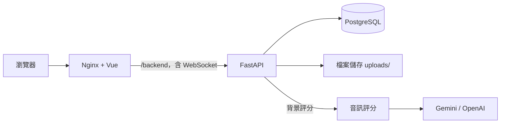

# 鋼琴教學管理與課程推廣平台

一對一鋼琴課的教學平台。學生可以找課、和老師接洽、排課，並送出練習錄音取得回饋；老師可以管理課程與課表，在上課前看到學生的練習彙整。

## 功能

**訪客與學生**

- 瀏覽已發布課程，可篩選與排序
- 首頁找課助理：描述需求後最多追問兩題，只推薦資料庫裡的已發布課程
- 與老師的接洽對話（即時訊息），輸入綁定碼後進入課程
- 查看課表，從可上課時段約課、調課，或提出請假
- 錄音或上傳音檔繳交作業，取得音高、節奏、文字回饋與對照樂譜

**老師**

- 註冊後經管理員審核，再管理工作室與課程
- 產生綁定碼或限時綁定碼，管理已綁定的學生
- 設定可上課時段、每週可上課時間與固定上課時間，處理課務申請
- 發作業（參考 MIDI、教材、期限），查看學生的練習回饋
- 上課前查看課前摘要：這位學生從上一堂結束到這一堂開始前的練習彙整

**管理員**

- 審核老師申請、查看師生名單
- 處理忘記密碼申請、和老師與學生對話

**尚未完成：** AI 測驗（目前只有原型 API）、獨立的搜尋頁與課程詳情頁。

## 技術

| 類別 | 使用 |
| --- | --- |
| 前端 | Vue 3、TypeScript、Vite、Pinia、Vue Router |
| 後端 | FastAPI、SQLAlchemy、Alembic（Python 3.12） |
| 資料庫 | PostgreSQL 17 |
| 音訊評分 | Basic Pitch、librosa、pretty_midi、music21 |
| 文字生成 | Gemini 或 OpenAI；沒有金鑰或呼叫失敗時改用規則產生的文字 |
| 部署 | Docker Compose、Nginx |

## 系統架構



學生送出錄音後，後端在背景把錄音和參考 MIDI 比對。評分失敗會顯示失敗狀態，不記成 0 分。

## 專案結構

```text
.
├── backend/             FastAPI 後端（routers、services、repositories、models）
│   ├── alembic/         資料庫 Migration
│   └── audio_scoring/   練習錄音評分
├── frontend/            Vue 前端
├── tests/               自動測試
├── scripts/             驗證與維運工具
├── deploy/              雲端部署用的 Dockerfile 與啟動腳本
├── docs/                規格、架構與操作文件
├── GLOSSARY.md          專案用語
└── docker-compose.yml   本機啟動設定
```

## 快速開始

需要 [Docker Desktop](https://www.docker.com/products/docker-desktop/)。以下指令都在專案根目錄執行。

1. 建立環境變數檔，並把 `SESSION_SECRET_KEY` 換成自己產生的隨機字串。這個檔案不要提交到 Git。

   ```bash
   cp .env.example .env
   ```

2. 啟動。第一次要加 `--build`，資料庫會在啟動時自動升級。

   ```bash
   docker compose up --build
   ```

3. 打開網站。

   | 服務 | 網址 |
   | --- | --- |
   | 網站 | http://localhost |
   | API 文件 | http://localhost:8000/docs |

停止服務：

```bash
docker compose stop
```

### 選用設定

都寫在 `.env`，沒有設定時網站仍可用 Email 登入。

| 變數 | 用途 |
| --- | --- |
| `ADMIN_EMAIL`、`ADMIN_PASSWORD` | 啟動時建立管理員帳號 |
| `GOOGLE_CLIENT_ID`、`GOOGLE_CLIENT_SECRET`、`GOOGLE_REDIRECT_URI` | Google 登入 |
| `GEMINI_API_KEY`、`OPENAI_API_KEY`、`LLM_PROVIDER` | 練習回饋與課前摘要的文字生成 |

## 測試

需要先啟動 PostgreSQL，並在 `frontend/` 執行過 `npm install`。

```bash
docker compose up -d postgres
```

```bash
python scripts/verify_merge.py
```

這個指令會執行 Migration、後端測試、Model 差異檢查、Vue 程式與型別檢查，以及正式版建置。它只接受名稱以 `_test` 結尾的測試資料庫（`.env` 的 `TEST_DATABASE_URL`），不會動到開發資料。測試不跑真正的音訊辨識，用法見 [audio_scoring 說明](backend/audio_scoring/README.md)。

## 開發規則

- 從最新的 `main` 開分支，完成後開 Pull Request，細節見 [GitHub 協作說明](docs/GitHub團隊協作說明.md)。
- 資料表只用 Alembic 修改，不手動建表，也不改已共享的 Migration，細節見 [Migration 手冊](docs/database/migration-runbook.md)。
- `.env`、密碼、API 金鑰、證明文件與錄音不要提交。

## 文件

| 想了解 | 文件 |
| --- | --- |
| 產品需求與功能規格 | [PRD](docs/鋼琴教學管理與課程推廣平台_PRD.md)、[SRS](docs/SRS功能文件.md)、[功能範圍與規則](docs/功能範圍與規則說明.md) |
| 使用者操作流程 | [User Flow](docs/User_Flow.md) |
| 系統架構與開發流程 | [SAD](docs/SAD系統架構設計.md)、[開發驗證手冊](docs/專案架構與開發驗證手冊.md)、[重要決定（ADR）](docs/adr/) |
| 資料庫 | [資料表設計](docs/資料表設計.md)、[資料字典](docs/database/data-dictionary.md) |
| 後端與前端程式 | [後端說明](backend/README.md)、[前端說明](frontend/README.md) |
| 重點流程 | [登入註冊](docs/登入註冊邏輯說明文件.md)、[音訊評分](docs/音訊上傳與評分資料流程.md)、[首頁推薦](docs/智慧課程推薦系統流程設計.md) |
| 部署與維運 | [部署](docs/deployment.md)、[維運](docs/operations.md)、[共用本機 AI](docs/shared-local-ai.md)、[CI 與 PR](docs/ci-and-pr.md)、[資安](docs/資安管控建議表.md) |
| 專案用語 | [GLOSSARY](GLOSSARY.md) |
