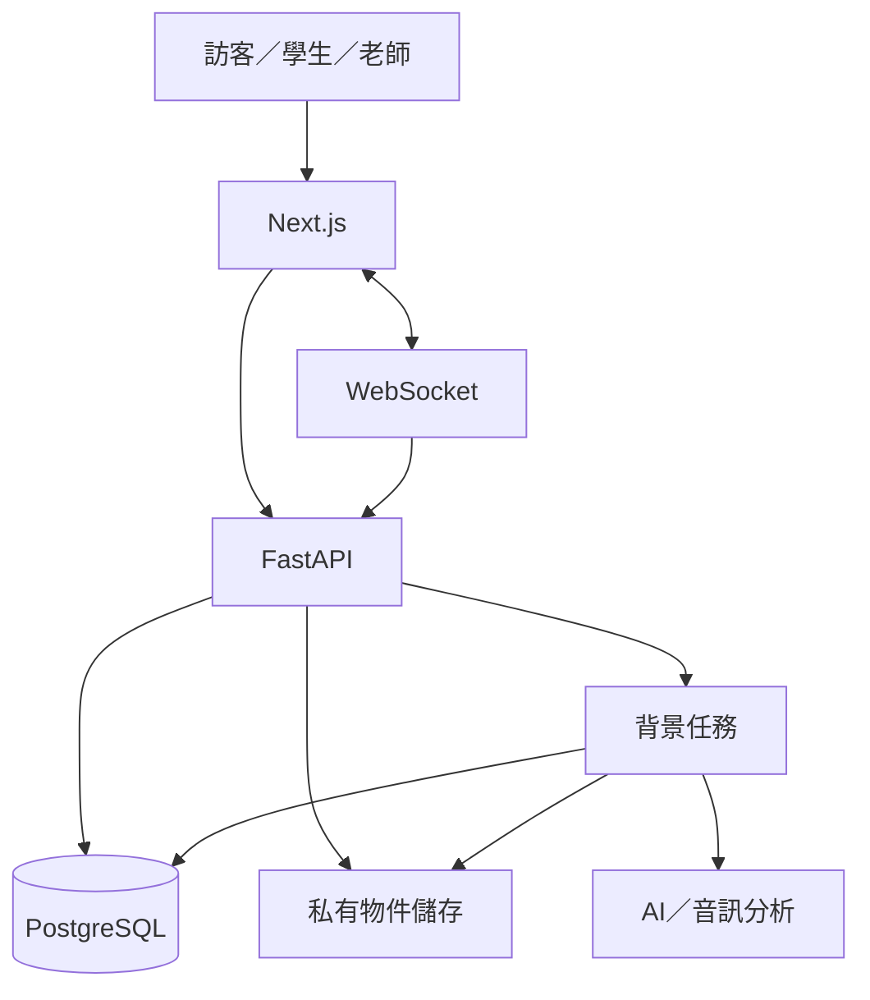
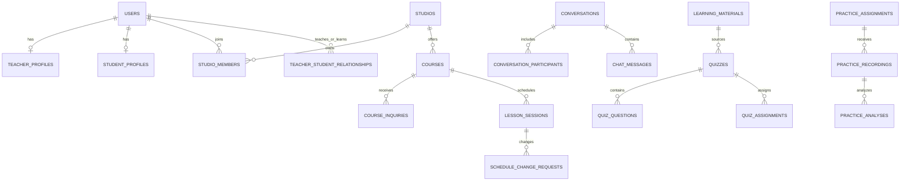

# 個人工作室智慧管理平台 Data 資料庫設計

| 項目 | 內容 |
| --- | --- |
| 版本 | V1.2 |
| 階段 | MVP 邏輯設計 |
| Database | PostgreSQL |
| 對應文件 | PRD V1.2、SRS V1.2、User Flow V1.2 |
| 最後更新 | 2026-09-24 |

> 本文件是邏輯 Schema 與 Migration 依據，仍須依實際 Repository 的既有 Model 與 Migration 核對。若現有實作不同，先列差異，不直接刪表或改欄位。

## 1. 設計原則

- UUID 作為主要主鍵。
- 主要表包含 `created_at`、`updated_at`；以下表格不重複列出。
- 時間使用 `timestamptz`，預設顯示 `Asia/Taipei`。
- 工作室領域資料必須含 `studio_id`，或能經不可歧義的外鍵鏈回工作室。
- 後端查詢不得只依資源 ID，必須加入登入者角色、成員或參與者範圍。
- 檔案內容放私有物件儲存，PostgreSQL 保存 metadata 與 storage key。
- AI 產出先保存為草稿／分析結果，不直接改課表或發布測驗。
- 所有重要狀態轉換由 Service 控制並以 Migration 管理 Schema。

## 2. 資料流總覽



## 3. 邏輯關聯



## 4. 核心資料表

### 4.1 帳號、角色與工作室

#### `users`

| 欄位 | 型別 | 限制／說明 |
| --- | --- | --- |
| id | uuid PK | 帳號 ID |
| email | varchar unique | 正規化後唯一 |
| password_hash | varchar | 不保存明碼 |
| role | enum | teacher、student、platform_admin；MVP 固定 |
| display_name | varchar | 顯示名稱 |
| status | enum | active、suspended、deleted |
| email_verified_at | timestamptz nullable | 驗證時間 |
| last_login_at | timestamptz nullable | 最近登入 |

#### `teacher_profiles`

| 欄位 | 型別 | 限制／說明 |
| --- | --- | --- |
| id | uuid PK | 教師檔案 ID |
| user_id | uuid FK unique | → users.id，users.role 必須為 teacher |
| public_name | varchar | 對外名稱 |
| bio | text nullable | 經歷與介紹 |
| avatar_file_id | uuid FK nullable | → stored_files.id |
| specialties | jsonb | 樂器、風格與專長 |
| is_public | boolean | 是否公開 |

#### `student_profiles`

| 欄位 | 型別 | 限制／說明 |
| --- | --- | --- |
| id | uuid PK | 學生檔案 ID |
| user_id | uuid FK unique | → users.id，users.role 必須為 student |
| name | varchar | 學生顯示名稱 |
| timezone | varchar | 預設 Asia/Taipei |
| status | enum | active、inactive、deleted |

MVP 不在此表保存供未來推薦用的長期程度、興趣或偏好檔案。

#### `studios`

| 欄位 | 型別 | 限制／說明 |
| --- | --- | --- |
| id | uuid PK | 工作室 ID |
| name | varchar | 名稱 |
| slug | varchar unique | 公開網址識別 |
| description | text nullable | 公開介紹 |
| timezone | varchar | 預設 Asia/Taipei |
| status | enum | active、suspended、closed |

#### `studio_members`

| 欄位 | 型別 | 限制／說明 |
| --- | --- | --- |
| id | uuid PK | 關聯 ID |
| studio_id | uuid FK | → studios.id |
| user_id | uuid FK | → users.id |
| role | enum | owner、admin、teacher、assistant |
| status | enum | invited、active、disabled |
| joined_at | timestamptz nullable | 加入時間 |

限制：`unique(studio_id, user_id)`。

### 4.2 課程、洽詢與師生關係

#### `course_categories`

| 欄位 | 型別 | 說明 |
| --- | --- | --- |
| id | uuid PK | 類別 ID |
| name | varchar unique | 鋼琴、二胡、歌唱等 |
| parent_id | uuid FK nullable | 階層分類 |
| status | enum | active、inactive |

#### `courses`

| 欄位 | 型別 | 限制／說明 |
| --- | --- | --- |
| id | uuid PK | 課程 ID |
| studio_id | uuid FK | → studios.id |
| teacher_profile_id | uuid FK | → teacher_profiles.id |
| category_id | uuid FK | → course_categories.id |
| title | varchar | 課程名稱 |
| description | text | 課程內容 |
| learning_goals | jsonb | 學習目標 |
| format | enum | one_on_one、group |
| delivery_mode | enum | onsite、online、hybrid |
| city | varchar nullable | 城市 |
| district | varchar nullable | 行政區 |
| price_amount | numeric(12,2) | 不得為負 |
| currency | char(3) | 預設 TWD |
| duration_minutes | integer | > 0 |
| min_level | enum | beginner、elementary、intermediate、advanced、uncertain |
| max_level | enum | 同上 |
| status | enum | draft、published、paused、archived |
| inquiry_enabled | boolean | 是否接受洽詢 |
| version | integer | 樂觀鎖版本 |

#### `course_inquiries`

| 欄位 | 型別 | 限制／說明 |
| --- | --- | --- |
| id | uuid PK | 洽詢 ID |
| studio_id | uuid FK | 必須由 course_id 反查，不信任前端 |
| course_id | uuid FK | → courses.id |
| student_user_id | uuid FK | → users.id |
| recommendation_session_id | uuid FK nullable | 推薦來源 |
| message | text nullable | 學生說明 |
| status | enum | pending、accepted、rejected、cancelled |
| handled_by | uuid FK nullable | 老師帳號 |
| handled_at | timestamptz nullable | 處理時間 |

限制：可依需求建立「同學生＋同課程＋pending」部分唯一索引。

#### `student_invitations`

| 欄位 | 型別 | 限制／說明 |
| --- | --- | --- |
| id | uuid PK | 邀請 ID |
| studio_id | uuid FK | → studios.id |
| teacher_user_id | uuid FK | 邀請老師 |
| course_id | uuid FK nullable | 指定課程 |
| code_hash | varchar unique | 只存雜湊 |
| expires_at | timestamptz | 到期時間 |
| max_uses | integer | > 0 |
| used_count | integer | 預設 0 |
| status | enum | active、used、expired、revoked |

#### `teacher_student_relationships`

| 欄位 | 型別 | 限制／說明 |
| --- | --- | --- |
| id | uuid PK | 關係 ID |
| studio_id | uuid FK | → studios.id |
| teacher_user_id | uuid FK | users.role = teacher |
| student_user_id | uuid FK | users.role = student |
| course_id | uuid FK nullable | 關聯課程 |
| source_type | enum | inquiry、invitation、manual_import |
| source_id | uuid nullable | 洽詢或邀請來源 |
| status | enum | active、paused、ended |
| started_at | timestamptz | 開始時間 |
| ended_at | timestamptz nullable | 結束時間 |

限制：建議 `unique(studio_id, teacher_user_id, student_user_id, course_id)`；若允許歷史重啟，改用 active 部分唯一索引。

### 4.3 課堂與異動

#### `lesson_sessions`

| 欄位 | 型別 | 限制／說明 |
| --- | --- | --- |
| id | uuid PK | 課堂 ID |
| studio_id | uuid FK | → studios.id |
| course_id | uuid FK | → courses.id |
| teacher_user_id | uuid FK | 老師 |
| student_user_id | uuid FK | MVP 一對一課堂；團體課未來另拆 participants |
| starts_at | timestamptz | 開始時間 |
| ends_at | timestamptz | 必須晚於 starts_at |
| status | enum | scheduled、completed、cancelled、rescheduled |
| location_snapshot | jsonb nullable | 當次地點／線上資訊 |
| version | integer | 異動時檢查 |

#### `schedule_change_requests`

| 欄位 | 型別 | 限制／說明 |
| --- | --- | --- |
| id | uuid PK | 申請 ID |
| studio_id | uuid FK | → studios.id |
| lesson_session_id | uuid FK | → lesson_sessions.id |
| request_type | enum | leave、reschedule、cancel |
| requester_user_id | uuid FK | 學生或老師 |
| before_payload | jsonb | 原課堂快照 |
| proposed_payload | jsonb | 申請內容／新時段 |
| message | text nullable | 說明 |
| status | enum | draft、pending、proposed、approved、executed、rejected、withdrawn、expired、conflict |
| expected_session_version | integer | 建立時版本 |
| teacher_decision_by | uuid FK nullable | 決策老師 |
| teacher_decision_at | timestamptz nullable | 決策時間 |
| expires_at | timestamptz nullable | 到期時間 |
| executed_at | timestamptz nullable | 執行時間 |

只有老師確認後可進入 approved；只有交易成功後可進入 executed。

### 4.4 一對一聊天

#### `conversations`

| 欄位 | 型別 | 限制／說明 |
| --- | --- | --- |
| id | uuid PK | 對話 ID |
| type | enum | teacher_student、ai_customer_service |
| studio_id | uuid FK nullable | 師生對話所屬工作室 |
| relationship_id | uuid FK nullable | → teacher_student_relationships.id |
| status | enum | active、closed |
| last_message_at | timestamptz nullable | 排序用 |

師生對話建議對 active relationship 建立唯一限制；AI 客服對話可依匿名 session 或 user 分開建立。

#### `conversation_participants`

| 欄位 | 型別 | 限制／說明 |
| --- | --- | --- |
| id | uuid PK | 參與 ID |
| conversation_id | uuid FK | → conversations.id |
| user_id | uuid FK | → users.id；匿名 AI 客服可改用 session 表 |
| participant_role | enum | teacher、student |
| joined_at | timestamptz | 加入時間 |
| last_read_message_id | uuid nullable | 已讀到的訊息 |
| last_read_at | timestamptz nullable | 已讀時間 |

限制：`unique(conversation_id, user_id)`；已讀位置只能單調向前。

#### `chat_messages`

| 欄位 | 型別 | 限制／說明 |
| --- | --- | --- |
| id | uuid PK | 訊息 ID |
| conversation_id | uuid FK | → conversations.id |
| sender_type | enum | user、ai、system |
| sender_user_id | uuid FK nullable | user 訊息必填 |
| client_message_id | uuid nullable | 客戶端重送去重 |
| content | text | MVP 純文字，限制長度 |
| status | enum | sent、deleted |
| created_at | timestamptz | 訊息時間 |

限制：`unique(sender_user_id, client_message_id)` where client_message_id is not null。

### 4.5 推薦與 AI 客服

#### `recommendation_sessions`

| 欄位 | 型別 | 說明 |
| --- | --- | --- |
| id | uuid PK | 推薦階段 ID |
| user_id | uuid FK nullable | 登入學生可填；訪客為空 |
| anonymous_session_id | varchar nullable | 短效匿名識別 |
| status | enum | collecting、clarifying、ready、recommended、no_match、ended |
| clarification_count | smallint | 0–2 |
| model_version | varchar nullable | 抽取模型版本 |
| ranking_version | varchar | 排序版本 |

#### `recommendation_preferences`

| 欄位 | 型別 | 說明 |
| --- | --- | --- |
| id | uuid PK | 條件 ID |
| recommendation_session_id | uuid FK unique | → sessions.id |
| category_id | uuid FK nullable | 課程類型 |
| learning_goal | text nullable | 目標 |
| assessed_level | enum | beginner、elementary、intermediate、advanced、uncertain |
| level_confidence | numeric(5,4) nullable | 0–1 |
| budget_min | numeric(12,2) nullable | 最低預算 |
| budget_max | numeric(12,2) nullable | 最高預算 |
| location | jsonb | 地區 |
| delivery_modes | jsonb | 授課方式 |
| time_preferences | jsonb | 時間偏好 |
| evidence | jsonb | 當次對談證據；不形成長期學生檔案 |

#### `recommendation_results`

| 欄位 | 型別 | 說明 |
| --- | --- | --- |
| id | uuid PK | 結果 ID |
| recommendation_session_id | uuid FK | → sessions.id |
| course_id | uuid FK | → courses.id |
| rank | integer | 順位 |
| total_score | numeric(6,3) | 規則分數 |
| score_breakdown | jsonb | 分數分解 |
| reason_text | text | 推薦理由 |
| course_snapshot | jsonb | 當下必要公開欄位 |

### 4.6 檔案與背景工作

#### `stored_files`

| 欄位 | 型別 | 限制／說明 |
| --- | --- | --- |
| id | uuid PK | 檔案 ID |
| owner_user_id | uuid FK | 擁有者 |
| studio_id | uuid FK nullable | 工作室範圍 |
| purpose | enum | avatar、learning_material、score_image、reference_audio、practice_recording |
| original_name | varchar | 顯示名稱，需清理 |
| storage_key | varchar unique | 私有物件 key |
| mime_type | varchar | 後端檢測結果 |
| size_bytes | bigint | 大小 |
| sha256 | varchar | 完整性／重複檢查 |
| scan_status | enum | pending、clean、rejected、failed |
| processing_status | enum | pending、ready、failed |
| deleted_at | timestamptz nullable | 軟刪除 |

#### `background_jobs`

| 欄位 | 型別 | 說明 |
| --- | --- | --- |
| id | uuid PK | 任務 ID |
| job_type | enum | material_extract、quiz_generate、reference_analyze、practice_analyze |
| aggregate_type | varchar | 關聯資料類型 |
| aggregate_id | uuid | 關聯 ID |
| idempotency_key | varchar unique | 安全重試 |
| status | enum | pending、processing、succeeded、failed、cancelled |
| retry_count | integer | 重試次數 |
| error_code | varchar nullable | 失敗碼，不存敏感內容 |
| started_at | timestamptz nullable | 開始 |
| finished_at | timestamptz nullable | 完成 |

### 4.7 教材與測驗

#### `learning_materials`

| 欄位 | 型別 | 說明 |
| --- | --- | --- |
| id | uuid PK | 教材 ID |
| studio_id | uuid FK | → studios.id |
| teacher_user_id | uuid FK | 上傳老師 |
| title | varchar | 教材名稱 |
| file_id | uuid FK | → stored_files.id |
| extracted_text | text nullable | 擷取文字，需限制存取 |
| status | enum | uploaded、processing、ready、failed、archived |

#### `quizzes`

| 欄位 | 型別 | 說明 |
| --- | --- | --- |
| id | uuid PK | 測驗 ID |
| studio_id | uuid FK | → studios.id |
| teacher_user_id | uuid FK | 建立老師 |
| material_id | uuid FK | → learning_materials.id |
| title | varchar | 名稱 |
| status | enum | generating、draft、published、archived |
| version | integer | 版本 |
| generation_model | varchar nullable | AI 模型版本 |
| published_at | timestamptz nullable | 發布時間 |

#### `quiz_questions`

| 欄位 | 型別 | 說明 |
| --- | --- | --- |
| id | uuid PK | 題目 ID |
| quiz_id | uuid FK | → quizzes.id |
| question_type | enum | single_choice、true_false |
| sequence_no | integer | 題序 |
| prompt | text | 題目 |
| options | jsonb | 選項；是非題可固定 |
| correct_answer | jsonb | 老師核准答案 |
| explanation | text nullable | 解析 |
| source_reference | jsonb nullable | 教材頁碼／片段 |
| teacher_reviewed | boolean | 發布前必須 true |

#### `quiz_assignments`

| 欄位 | 型別 | 說明 |
| --- | --- | --- |
| id | uuid PK | 指派 ID |
| quiz_id | uuid FK | → quizzes.id |
| student_user_id | uuid FK | 指派學生 |
| assigned_by | uuid FK | 老師 |
| due_at | timestamptz nullable | 期限 |
| status | enum | assigned、started、submitted、expired |

#### `quiz_attempts`

| 欄位 | 型別 | 說明 |
| --- | --- | --- |
| id | uuid PK | 作答 ID |
| quiz_assignment_id | uuid FK | → quiz_assignments.id |
| quiz_version | integer | 作答版本快照 |
| started_at | timestamptz | 開始 |
| submitted_at | timestamptz nullable | 提交 |
| score | numeric(6,2) nullable | 分數 |
| total_points | numeric(6,2) | 總分 |
| status | enum | in_progress、submitted、graded |

#### `quiz_answers`

| 欄位 | 型別 | 說明 |
| --- | --- | --- |
| id | uuid PK | 答案 ID |
| attempt_id | uuid FK | → quiz_attempts.id |
| question_id | uuid FK | → quiz_questions.id |
| answer_payload | jsonb | 學生答案 |
| is_correct | boolean nullable | 批改結果 |
| points_awarded | numeric(6,2) nullable | 得分 |

限制：`unique(attempt_id, question_id)`。

### 4.8 AI 鋼琴練習

#### `practice_assignments`

| 欄位 | 型別 | 說明 |
| --- | --- | --- |
| id | uuid PK | 練習任務 ID |
| studio_id | uuid FK | → studios.id |
| teacher_user_id | uuid FK | 老師 |
| student_user_id | uuid FK | 學生 |
| title | varchar | 任務名稱 |
| instructions | text nullable | 練習說明 |
| reference_type | enum | score_image、reference_audio |
| reference_file_id | uuid FK | → stored_files.id |
| reference_metadata | jsonb | 小節、拍號、速度等可用 metadata |
| status | enum | draft、assigned、closed |
| due_at | timestamptz nullable | 期限 |

#### `practice_recordings`

| 欄位 | 型別 | 說明 |
| --- | --- | --- |
| id | uuid PK | 錄音 ID |
| practice_assignment_id | uuid FK | → assignments.id |
| student_user_id | uuid FK | 必須與任務學生一致 |
| audio_file_id | uuid FK | → stored_files.id |
| duration_ms | integer | 錄音長度 |
| status | enum | uploaded、processing、analyzed、failed |
| submitted_at | timestamptz | 提交時間 |

#### `practice_analyses`

| 欄位 | 型別 | 說明 |
| --- | --- | --- |
| id | uuid PK | 分析 ID |
| practice_recording_id | uuid FK | → recordings.id |
| analysis_version | varchar | 模型／規則版本 |
| alignment_method | varchar | 使用的對齊方法 |
| overall_confidence | numeric(5,4) | 0–1 |
| overall_summary | text | 概略摘要 |
| measure_feedback | jsonb | 小節／區段、類型、信心、建議，不存虛假精密值 |
| quality_flags | jsonb | 雜音、截斷、對齊失敗等 |
| status | enum | processing、completed、low_confidence、failed |
| reviewed_by_teacher_at | timestamptz nullable | 老師查看／覆核 |

## 5. 稽核

#### `audit_logs`

| 欄位 | 型別 | 說明 |
| --- | --- | --- |
| id | uuid PK | 稽核 ID |
| studio_id | uuid FK nullable | 工作室範圍 |
| actor_user_id | uuid FK nullable | 操作者 |
| actor_type | enum | user、system、platform_admin |
| action | varchar | 動作代碼 |
| target_type | varchar | 資源類型 |
| target_id | uuid nullable | 資源 ID |
| result | enum | success、failure |
| metadata | jsonb | 遮罩後資訊 |
| request_id | varchar nullable | 追蹤 ID |
| created_at | timestamptz | 時間 |

## 6. 一致性與狀態規則

### 6.1 公開課程

```text
可公開／推薦 = courses.status = published
             AND courses.inquiry_enabled = true
             AND studios.status = active
```

### 6.2 師生關係

```text
洽詢建立關係 = inquiry.status 由 pending → accepted
邀請建立關係 = invitation 有效且學生明確確認
```

關係建立與來源狀態更新須在同一交易中完成並具冪等性。

### 6.3 課表異動

```text
可執行 = request.status = approved
       AND teacher_decision_at IS NOT NULL
       AND lesson.version = expected_session_version
       AND 權限與時段重驗通過
```

### 6.4 測驗發布

```text
可發布 = quiz.status = draft
       AND 題目數 > 0
       AND 每題 teacher_reviewed = true
       AND 每題有合法答案
```

### 6.5 鋼琴回饋

- `overall_confidence` 低於門檻時使用 `low_confidence`。
- 低信心結果不得產生精密數值斷言。
- `measure_feedback` 每項至少含區段、問題類型、信心與建議。
- 對齊失敗可降級為時間區段／整體回饋，但 UI 必須說明。

## 7. 建議索引

| 目的 | 索引／限制 |
| --- | --- |
| 公開課程 | courses(status, category_id)、courses(studio_id, status) |
| 課表 | lesson_sessions(teacher_user_id, starts_at)、lesson_sessions(student_user_id, starts_at) |
| 待處理申請 | schedule_change_requests(studio_id, status, created_at) |
| 待處理洽詢 | course_inquiries(studio_id, status, created_at) |
| 聊天列表 | conversations(last_message_at)、conversation_participants(user_id, conversation_id) |
| 訊息分頁 | chat_messages(conversation_id, created_at, id) |
| 訊息去重 | chat_messages(sender_user_id, client_message_id) unique where not null |
| 邀請 | student_invitations(code_hash) unique |
| 測驗待辦 | quiz_assignments(student_user_id, status, due_at) |
| 練習待辦 | practice_assignments(student_user_id, status, due_at) |
| 背景任務 | background_jobs(status, created_at)、idempotency_key unique |

## 8. 建議 Migration 順序

1. `users`、Profile、`studios`、`studio_members`。
2. 課程類別、課程、洽詢、邀請與師生關係。
3. 課堂與異動申請。
4. 對話、參與者與聊天訊息。
5. `stored_files` 與 `background_jobs`。
6. 教材、測驗、題目、指派與作答。
7. 練習任務、錄音與分析。
8. 推薦 session／條件／結果及稽核。

每個 Migration 應可單獨升級與降級；不得一次建立全部資料表後直接修改正式資料庫。

## 9. 尚待實作前確認

1. 認證採 Cookie Session 或 JWT，以及撤銷方式。
2. 老師是否可同時屬於多個工作室。
3. 團體課是否納入第一版；目前 `lesson_sessions` 先以一對一為主。
4. 教材正式支援的 MIME、大小與頁數限制。
5. 錄音格式、最大長度、取樣率及保留期限。
6. 鋼琴分析技術與信心門檻的原型測試結果。
7. AI 客服對談與測驗／錄音的正式保留期限。

