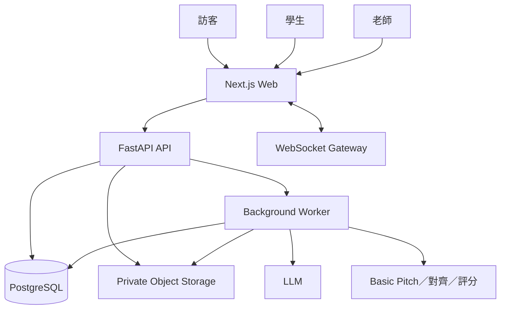
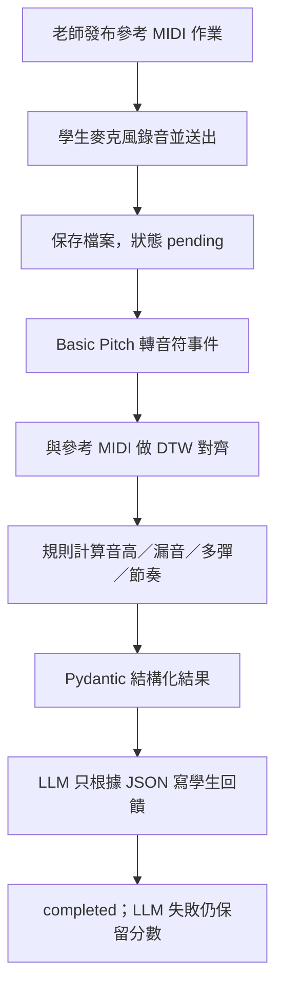
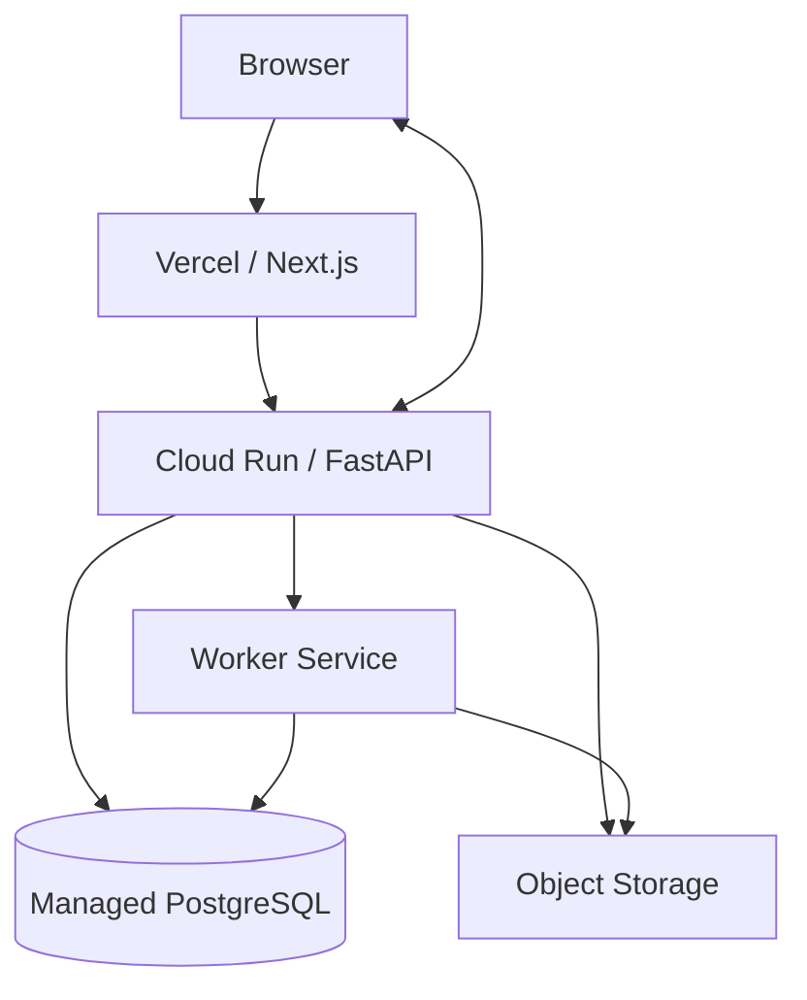

# 鋼琴教學管理與課程推廣平台 SAD

| 項目 | 內容 |
| --- | --- |
| 版本 | V1.2 |
| 文件類型 | Software Architecture Document |
| 最後更新 | 2026-09-30 |
| 對應文件 | PRD、SRS、User Flow、資料表設計、功能製作與分工說明 |

> 本文件說明系統怎麼切層與呼叫。不代表現有 Repository 已全部實作。若與程式碼不同，先列差異，不直接大搬家。

## 1. 架構目標

- 公開找課、老師工作區與學生工作區共用同一套 API 與權限模型。
- 以工作室作為老師端資料隔離單位。
- 僅鋼琴；訪客找課後須註冊，站內洽詢，雙向同意才成為正式師生。
- 即時聊天可斷線重連，且不遺失已寫入訊息。
- AI 只產生草稿或文字回饋，不決定權限、不改課表、不定分數。
- 教材、參考 MIDI 與學生錄音放私有檔案儲存，資料庫只存 metadata。
- 高成本音訊分析／LLM 與一般 HTTP Request 分開，並保存處理狀態。

## 2. 系統脈絡



平台維運管理員第一版只做必要帳號／異常與稽核，完整管理員介面延後。

## 3. 容器與責任

| 元件 | 主要責任 |
| --- | --- |
| Next.js | 公開課程／推薦、老師／學生頁面、錄音 UI、聊天 UI |
| FastAPI | 登入、REST API、權限、狀態機、WebSocket 驗證、建立背景任務 |
| PostgreSQL | 帳號、課務、洽詢、訊息、練習結果、課前摘要、測驗與稽核 |
| Object Storage | 教材、參考 MIDI、學生錄音 |
| Background Worker | 音訊轉音符、MIDI 對齊、規則評分、LLM 回饋、課前摘要、出題草稿 |
| LLM | 推薦條件抽取、推薦理由、學生回饋文字、課前摘要文字、測驗題目草稿 |
| 音訊／評分 | Basic Pitch 轉音符事件，再與參考 MIDI 對齊並計算音高／節奏 |

MVP 可先同一個 FastAPI 服務，但程式仍維持模組邊界；音訊處理不得長時間佔用一般 API worker。

## 4. 後端模組

實際 Repository 使用 `backend/routers/`，不是 `backend/api/`。目標結構：

```text
backend/
├── routers/          ← API 入口
│   ├── auth.py
│   ├── courses.py
│   ├── inquiries.py
│   ├── relationships.py
│   ├── lessons.py
│   ├── chats.py
│   ├── quizzes.py
│   ├── practice.py
│   ├── summaries.py
│   └── recommendations.py
├── services/
├── repositories/
├── models/
├── schemas/
├── core/
├── workers/
└── tests/
```

`app.py` 仍是啟動入口。現況若只有空資料夾，先依功能補檔，不一次搬動全部程式。

## 5. 呼叫關係

```text
REST / WebSocket Endpoint
  → Authentication / Authorization
  → Service：商業規則與狀態轉換
  → Repository：受工作室／使用者／修課範圍限制的查詢
  → SQLAlchemy / PostgreSQL
```

慢速工作：

```text
Service 建立提交／任務並 Commit
  → Worker 取得任務
  → Object Storage / 音訊分析 / LLM
  → 驗證 Structured Result
  → 更新 pending → processing → completed／failed
```

前端用狀態查詢結果，不假設一次 HTTP 就能做完錄音分析。

## 6. Auth 與授權

- 註冊時角色為 teacher 或 student；MVP 不可自行變更。
- 第一版使用 HttpOnly Cookie Session，只保存使用者編號。不使用 JWT。
- 老師端工作室操作須驗證有效 `studio_members`。
- 學生個人資源查詢固定加上目前 `user_id`。
- 洽詢權限與正式師生權限分開：洽詢中不能讀教材、錄音、聊天與課前摘要。
- Chat 同時驗證 conversation member 與有效師生關係。
- 公開課程 API 只回公開欄位，不帶學生練習或成績。

## 7. 找課、推薦與洽詢

```text
訪客描述需求
  → LLM 抽取條件與程度證據（未知不臆造，最多追問兩題）
  → 後端驗證並寫入 recommendation_sessions／preferences
  → DB 只篩有效工作室、已發布、可洽詢的鋼琴課
  → 規則排序後產生 recommendation_results
  → 訪客查看詳情；洽詢前先註冊／登入
  → course_inquiries 由學生送出、老師回覆
  → 雙向同意後才建立 studio_student_bindings 與 enrollments
```

LLM 不編造不存在的課程，也不把一次練習分數當成正式鋼琴程度。

## 8. 即時聊天架構

1. Client 用 REST 取得對話列表與歷史。
2. Client 以已驗證 Session 建立 WebSocket。
3. 每次訂閱／發送再驗證 membership。
4. 訊息以 `client_message_id` 去重，Service 先寫 DB。
5. Commit 成功後向在線收件人推送。
6. Client 更新讀取進度，後端計算未讀。
7. 重連時以 `after_message_id` 補抓。

不把「WebSocket 推送成功」當成資料已保存。

## 9. 鋼琴練習回饋

必要參考答案為校驗過的 MIDI。樂譜圖片或音檔轉參考答案延後，不進入第一版架構。

驗收範圍：短曲、單音或簡單雙手、無踏板。邊彈邊提示不做。



規則：

- 音高與節奏分開計分；音對但拍不齊要分開說明。
- Extra Note 先記錄，MVP 可不直接扣總分。
- 分析失敗不能顯示 0 分。
- LLM 不直接聽原始音訊自由打分，也不編造 JSON 沒有的小節或音符。
- 低信心時縮小主張範圍或請學生重錄。

目前原型在 `score_test/midi_test.py`，正式功能再搬進 service／worker。

## 10. 老師課前摘要

老師開啟課堂頁時產生或更新，不要求固定排程。

```text
驗證老師權限與本次課堂學生
  → 時間窗口：同修課上一堂已完成課 ends_at
    到 min(現在, 本堂 starts_at)
  → 只使用該學生、該老師、該修課的練習資料
  → 後端統計次數、完成／失敗、可比較的差異
  → LLM 寫教學摘要
  → 寫入 lesson_preparation_summaries
```

- 沒有平台紀錄時寫「此期間沒有平台練習紀錄」，不能說學生沒練習。
- 不同曲目不能直接比較總分來宣稱進步或退步。
- 新分析完成或課堂改期時，標記摘要需要更新。
- 摘要只給老師看，不向學生自動公開。

## 11. AI 測驗

- 教材先驗證檔案類型與歸屬，再抽取文字。
- 出題 Context 只含老師指定教材。
- AI 只輸出題目草稿，初始為 draft。
- 老師審核題幹、答案與解析後才發布。
- 批改使用老師核准的標準答案，作答時不再問 LLM。
- 交卷前不外洩答案；同一交卷不重複計分。

## 12. 檔案處理

1. Client 向 API 申請上傳。
2. API 驗證用途、角色、大小與允許類型（作業參考以 MIDI 為主）。
3. 檔案進私有儲存，狀態 pending。
4. 後端驗證檔頭／MIME。
5. Clean 後才建立分析或出題任務。
6. 下載用短效授權 URL 或受控串流，檔案不永久公開。

## 13. 交易與冪等

下列操作必須可重試且不重複生效：

- 接受洽詢與建立正式師生／修課。
- 老師核准課表異動。
- 建立聊天訊息。
- 提交測驗。
- 建立練習分析與課前摘要任務。

課表異動在單一資料庫交易中執行；申請核准不等於已改課，成功寫入後才是 executed。背景處理失敗不得把正式課表變成未知狀態。

## 14. Deployment



- 前端只保存公開設定。
- Backend、Worker 使用環境變數／Secret Manager；`.env` 不進 Git。
- WebSocket 若多 Instance，需要共享訊息機制。

## 15. 可觀測性

- 每個 Request／Job 使用 `request_id`／`job_id`。
- 記錄 API latency、任務 queue time、分析時長、AI 失敗、WebSocket 失敗。
- Log 遮罩 Email、聊天內容、檔案路徑與 prompt 原文。
- 練習與摘要保存分析版本、參考 MIDI 版本與來源提交，方便重試與追溯。

## 16. 架構待決策

已決定：網站使用 Next.js；登入使用 HttpOnly Cookie Session；第一版提供 Google 登入。

仍待決定：

1. Object Storage 供應商與上傳流程。
2. Background Job／Queue 技術。
3. WebSocket 多 Instance 的廣播方式。
4. 錄音長度上限、評分容許誤差與回饋延遲目標。

以上不改變已定方向：僅鋼琴、網站雙端、MIDI 參考、錄完後快速回饋、課前摘要與站內洽詢。
