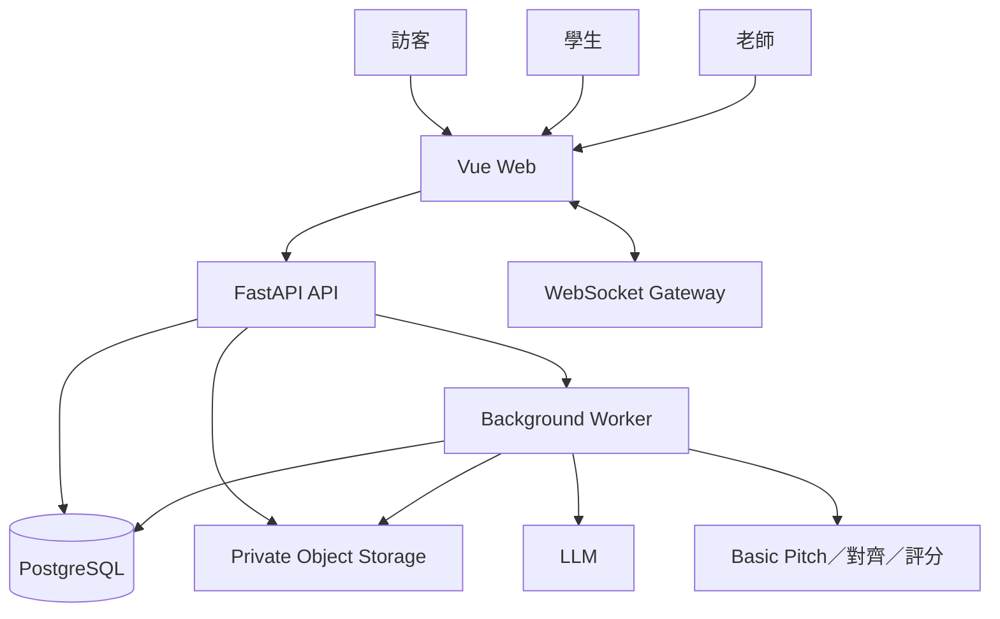
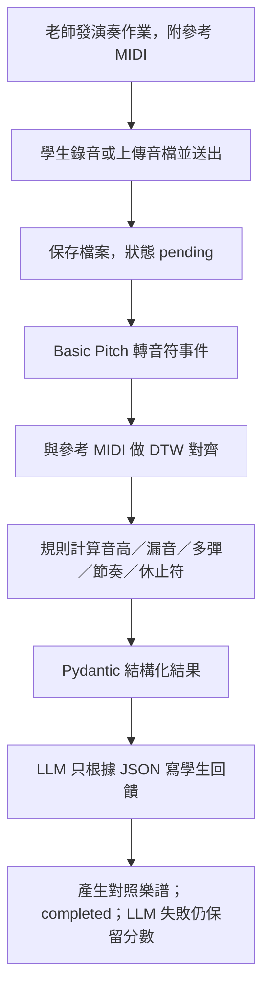
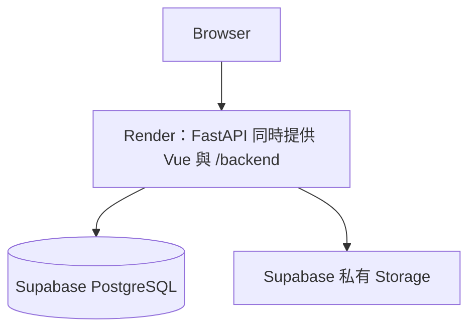

# 鋼琴教學管理與課程推廣平台 SAD

| 項目 | 內容 |
| --- | --- |
| 文件類型 | Software Architecture Document |
| 最後更新 | 2026-11-01 |
| 對應文件 | PRD、SRS、User Flow、資料表設計、功能範圍與規則說明 |

本文件以 PRD／SRS／User Flow 為準，說明系統分層與呼叫方式。畫面都在 Vue（`frontend/`），後端只提供 API，已不再有 Jinja 測試頁。本文中的獨立 Worker 是目標架構，目前還沒有；AI 測驗也還沒有實作。

## 1. 架構目標

- 公開找課、老師工作區與學生工作區共用同一套 API 與權限模型。
- 以老師與課程作為資料隔離單位。
- 僅鋼琴；訪客找課後須註冊。按洽詢建立接洽對話，輸入綁定碼後才使用該課教學功能。
- 即時聊天可斷線重連，且不遺失已寫入訊息。
- AI 只產生測驗草稿或文字回饋，不決定權限、不改課表、不定分數，也不自行發布測驗。
- 教材、參考 MIDI 與學生錄音放私有檔案儲存，資料庫只存 metadata。
- 高成本音訊分析／LLM 與一般 HTTP Request 分開，並保存處理狀態。

## 2. 系統脈絡



平台管理員目前有老師審核、師生名單、忘記密碼處理與對話，沒有獨立的稽核功能。

上圖是目標架構。目前可執行版本由 `backend/main.py` 啟動 FastAPI API，畫面由 Vue（`frontend/`）負責。檔案本機放 `uploads/`，`STORAGE_BACKEND=supabase` 時放 Supabase 私有 bucket。錄音評分用 FastAPI 的 BackgroundTasks 在同一個服務背景執行；獨立的 Background Worker 仍是目標狀態。

## 3. 目標容器與責任

| 元件 | 主要責任 |
| --- | --- |
| Vue | 公開課程／推薦、老師／學生／管理員頁面、錄音 UI、接洽對話 |
| FastAPI | 登入、REST API、權限、狀態機、WebSocket 驗證、建立背景任務（目前也執行音訊評分） |
| PostgreSQL | 帳號、課務、接洽對話、訊息、作業、練習結果、課前摘要、首頁推薦與語意向量 |
| 檔案儲存 | 教材、參考 MIDI、學生錄音、對照樂譜、圖片與證明文件。本機 `uploads/`，共用測試站 Supabase Storage |
| Background Worker（目標，尚未建立） | 音訊轉音符、MIDI 對齊、規則評分、LLM 回饋、課前摘要、出題草稿 |
| LLM | 學生回饋文字、課前摘要文字（Gemini 或 OpenAI，失敗時改用規則文字）。首頁推薦可選用共用本機模型 |
| 音訊／評分 | Basic Pitch 轉音符事件，再與參考 MIDI 對齊並計算音高／節奏 |

目前同一個 FastAPI 服務，程式維持模組邊界。音訊評分用 BackgroundTasks，不擋住送出請求，但仍佔用同一個服務的資源。

## 4. 後端模組

實際 Repository 使用下列共用分層；`backend/main.py` 是唯一正式啟動入口：

```text
backend/
├── main.py              建立 FastAPI、掛 Session／CORS、載入 router
├── routers/
│   ├── auth.py          註冊、登入、密碼、Google 驗證
│   ├── admin.py         老師審核、師生名單、忘記密碼處理
│   ├── public_courses.py、images.py、recommendations.py
│   ├── student.py       學生 API
│   ├── assignments.py   作業（老師與學生）
│   ├── support.py       管理員對話
│   ├── chat_ws.py       接洽對話 WebSocket
│   ├── health.py
│   └── teacher_*.py     老師端 API
├── services/
│   ├── practice.py      錄音評分流程
│   ├── assignment.py、availability.py、weekly_schedule.py
│   ├── recommendation.py、ai_*.py
│   ├── lesson_summary.py、llm.py
│   └── teacher_sync.py
├── audio_scoring/       錄音與參考 MIDI 比對評分
├── repositories/
├── models/
├── schemas/
├── dependencies/
│   ├── common.py
│   └── teacher.py
└── core/
    ├── uploads.py
    └── storage.py       本機與 Supabase 共用的檔案存取
```

新功能應延續 Router → Service → Repository → Model 的分層。背景工作可在需要時新增 `workers/`，不把規劃中的資料夾誤寫成已完成。

## 5. 呼叫關係

```text
REST / WebSocket Endpoint
  → Authentication / Authorization
  → Service：商業規則與狀態轉換
  → Repository：受老師／課程／目前使用者範圍限制的查詢
  → SQLAlchemy / PostgreSQL
```

慢速工作（目前用 BackgroundTasks，還沒有獨立 Worker）：

```text
Service 建立練習錄音並 Commit
  → Router 排一個背景工作
  → 檔案儲存 / 音訊分析 / LLM
  → 驗證結構化結果
  → 更新 pending → processing → completed／failed
```

前端用狀態查詢結果，不假設一次 HTTP 就能做完錄音分析。

## 6. Auth 與授權

- 註冊時角色為 teacher 或 student；MVP 不可自行變更。
- 第一版使用簽章 Session Cookie，只保存使用者編號。不使用 JWT。
- 老師只能操作自己的課程。學生個人資源查詢固定加上目前使用者。
- 未綁定時只能使用接洽對話，不能讀課表、錄音、練習回饋與課前摘要。
- Chat 同時驗證 conversation member 與有效師生關係。
- 公開課程 API 只回公開欄位，不帶學生練習或成績。

## 7. 找課、推薦與洽詢

```text
訪客描述需求
  → 後端用規則解析條件（未知不臆造，最多追問兩題）；設定共用本機模型時，模型提出的條件也由後端驗證
  → 寫入 recommendation_sessions
  → DB 只篩已發布的鋼琴課；有索引時再做語意排序
  → 寫入 recommendation_items，理由只由實際命中的欄位組成
  → 訪客查看詳情；洽詢前先註冊／登入
  → 學生按洽詢建立接洽對話
  → 老師貼綁定碼（或給限時綁定碼），學生輸入後進入該課
```

LLM 不編造不存在的課程，也不把一次練習分數當成正式鋼琴程度。細節見 `docs/智慧課程推薦系統流程設計.md`。

## 8. 接洽對話的即時傳遞

1. Client 用 REST 取得對話列表與歷史。
2. Client 以已驗證 Session 建立 WebSocket。
3. 每次訂閱／發送再驗證 membership。
4. 訊息以 `client_message_id` 去重，Service 先寫 DB。
5. Commit 成功後向在線收件人推送。
6. Client 更新讀取進度，後端計算未讀。
7. 重連時以 `after_message_id` 補抓。

不把「WebSocket 推送成功」當成資料已保存。

## 9. 鋼琴練習回饋

必要參考答案為校驗過的 MIDI。樂譜圖片或音檔轉參考答案延後，不進入第一版架構。

驗收範圍：短曲、單音或簡單雙手、無踏板。邊彈邊提示不做。



規則：

- 音高與節奏分開計分；音對但拍不齊要分開說明。
- 音高滿分 70、節奏滿分 30。
- 分析失敗不能顯示 0 分。
- LLM 不直接聽原始音訊自由打分，也不編造 JSON 沒有的小節或音符。
- 低信心時縮小主張範圍或請學生重錄。

程式在 `backend/services/practice.py`、`backend/audio_scoring/`；檔案路徑與步驟見 `docs/音訊上傳與評分資料流程.md`。

## 10. 老師課前摘要

老師在課表開啟一堂課時產生或更新（`GET /teacher/lessons/{lesson_id}/summary`），不用固定排程。

```text
驗證老師權限與本次課堂學生
  → 時間窗口：同一位學生、同一門課上一堂的結束時間到這一堂開始
  → 只使用該學生、該老師、該門課的練習資料
  → 後端統計次數、完成／失敗、可比較的差異
  → LLM 寫教學摘要
  → 寫入 lesson_preparation_summaries
```

- 沒有平台紀錄時寫「此期間沒有平台練習紀錄」，不能說學生沒練習。
- 不同曲目不能直接比較總分來宣稱進步或退步。
- 新分析完成或課堂改期時，來源指紋會變，下次開啟時重寫摘要。
- 摘要只給老師看，不向學生自動公開。

## 11. AI 測驗（尚未實作）

目前只有教材上傳與測驗列表的原型 API。下面是應有行為：

- 教材先驗證檔案類型與歸屬，再抽取文字。
- 出題 Context 只含老師指定教材。
- AI 只輸出題目草稿，初始為 draft。
- 老師審核題幹、答案與解析後才發布。
- 批改使用老師核准的標準答案，作答時不再問 LLM。
- 交卷前不外洩答案；同一交卷不重複計分。

## 12. 檔案處理

1. Client 把檔案送到 API。
2. API 驗證角色、歸屬、大小與類型（MIDI 與圖片檢查檔頭，錄音檢查副檔名）。
3. `backend/core/storage.py` 把檔案存進本機 `uploads/` 或 Supabase 私有 bucket，資料庫只存位置。
4. 資料庫提交失敗時清掉這次的新檔案；雲端刪除失敗記進 `storage_cleanup_jobs` 等重試。
5. 下載一律經後端檢查權限，檔案不永久公開。

檔案內容掃描還沒有實作。

## 13. 交易與冪等

下列操作必須可重試且不重複生效：

- 接受洽詢與建立正式師生／修課。
- 老師核准課表異動。
- 建立聊天訊息。
- 建立練習分析與課前摘要。

課表異動在單一資料庫交易中執行。背景處理失敗不得把正式課表變成未知狀態。

## 14. Deployment

本機：`docker-compose.yml` 啟動 Nginx＋Vue、FastAPI、PostgreSQL 三個容器。共用測試站：



- 前端只保存公開設定。
- 後端使用環境變數；`.env` 不進 Git。
- 細節見 `docs/deployment.md`、`docs/維運工作紀錄.md`。
- WebSocket 若多 Instance，需要共享訊息機制。

## 15. 可觀測性

目前有：`/health` 檢查資料庫、Docker 健康檢查、共用測試站的排程監控（見 `docs/operations.md`）。錄音保存送出當下的參考 MIDI 位置，課前摘要保存來源錄音與指紋。

目標，尚未實作：

- 每個 Request／Job 使用 `request_id`／`job_id`。
- 記錄 API latency、任務 queue time、分析時長、AI 失敗、WebSocket 失敗。
- Log 遮罩 Email、聊天內容、檔案路徑與 prompt 原文。

## 16. 架構待決策

已決定：正式畫面使用 Vue；後端使用 FastAPI；登入使用 Session Cookie；共用測試站的檔案放 Supabase Storage。Google 登入程式已在，金鑰依環境設定。

仍待決定：

1. Background Job／Queue 技術。
2. WebSocket 多 Instance 的廣播方式。
3. 錄音長度上限、評分容許誤差與回饋延遲目標。

以上不改變已定方向：僅鋼琴、網站雙端、MIDI 參考、錄完後快速回饋、課前摘要、接洽對話與老師審核後發布的 AI 測驗。
