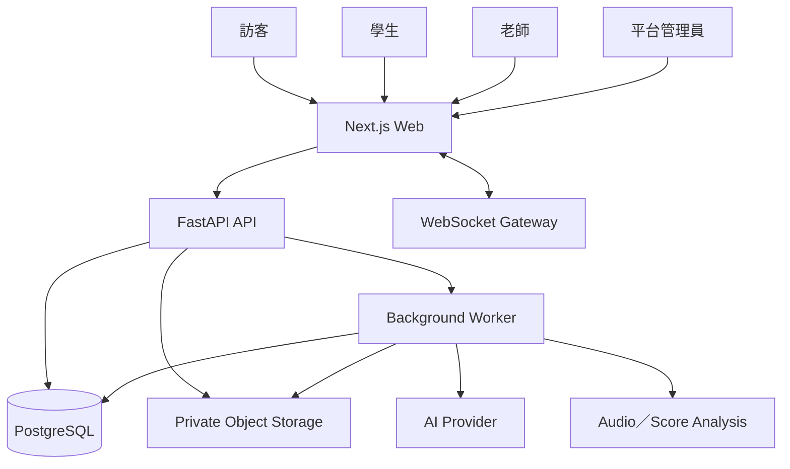
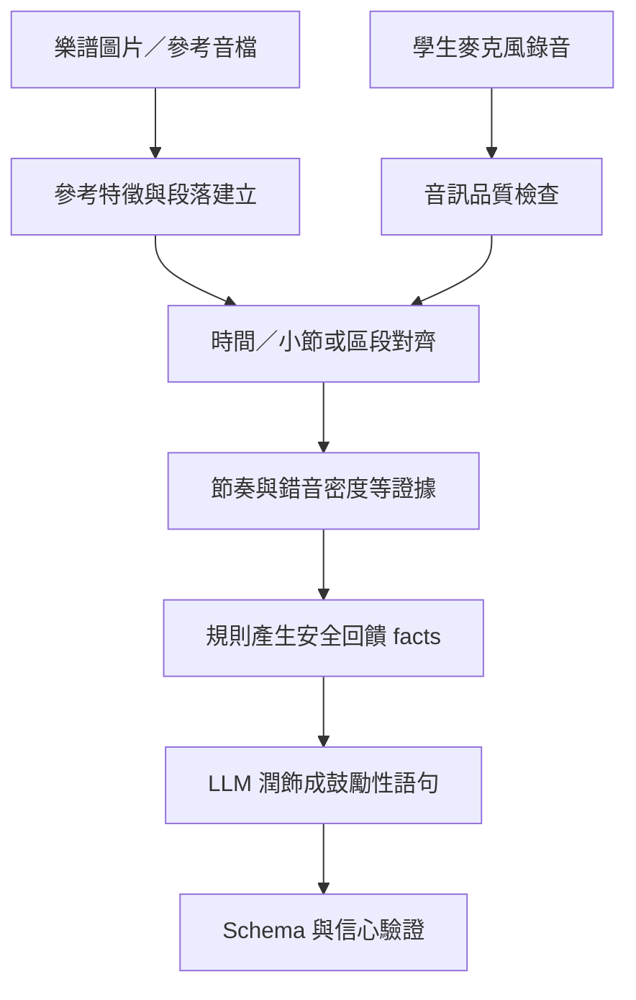
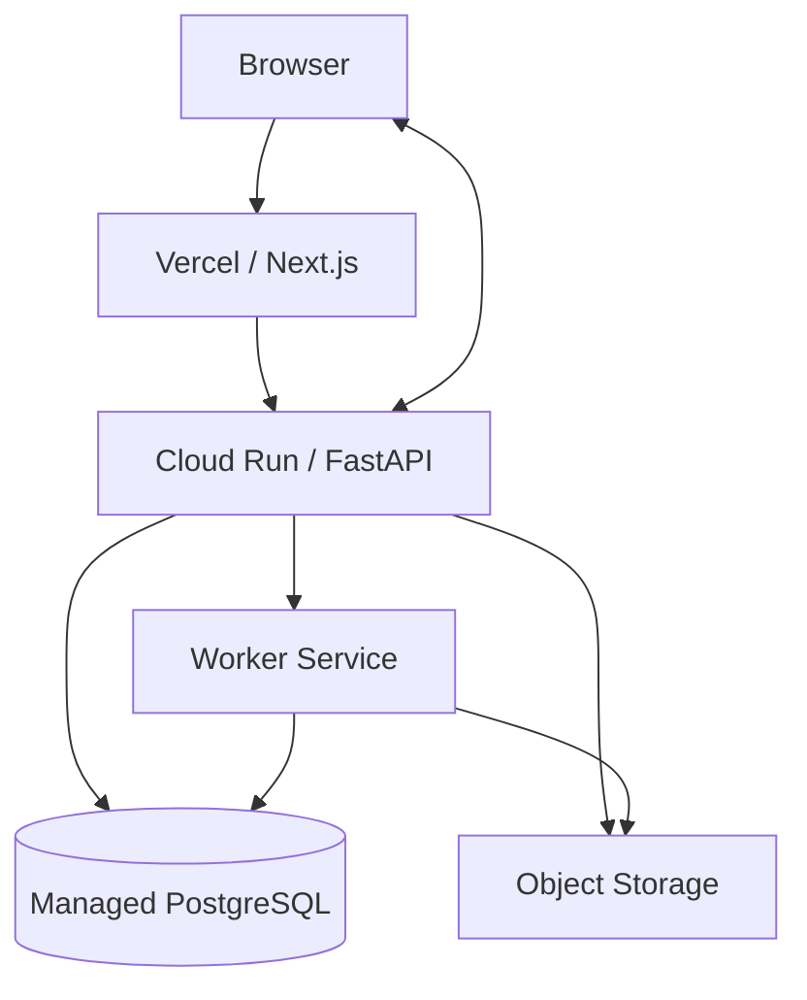

# 個人工作室智慧管理平台 SAD

| 項目 | 內容 |
| --- | --- |
| 版本 | V1.2 |
| 文件類型 | Software Architecture Document |
| 最後更新 | 2026-09-24 |

## 1. 架構目標

- 讓公開平台、老師後台與學生頁面共用一致的 API 與權限模型。
- 以工作室作為老師端資料隔離單位。
- 即時聊天可斷線重連且不遺失已寫入訊息。
- AI 輸出只能作為結構化草稿或回饋，不跨越授權與正式狀態機。
- 教材、樂譜與錄音由私有檔案儲存處理，不塞入 Database。
- 高成本 AI／音訊分析與一般 HTTP Request 分離。

## 2. 系統脈絡



## 3. 容器與責任

| 元件 | 主要責任 |
| --- | --- |
| Next.js | 公開頁、老師／學生頁面、表單、錄音 UI、聊天 UI |
| FastAPI | Auth、REST API、權限、狀態機、WebSocket 驗證、任務建立 |
| PostgreSQL | 帳號、課務、訊息、測驗、分析 metadata 與稽核 |
| Object Storage | 教材、樂譜、參考音檔與學生錄音 |
| Background Worker | 教材抽取、出題、樂譜／音訊預處理與錄音分析 |
| AI Provider | 條件抽取、平台 QA、題目草稿與自然語言回饋 |
| Audio／Score Analysis | 音高／節奏特徵、參考對齊與小節／區段證據 |

MVP 可先採單一 FastAPI Deployable，但程式內仍維持模組邊界；音訊處理不得長時間佔用 Web Request worker。

## 4. 後端模組

```text
backend/
├── api/
│   ├── auth.py
│   ├── courses.py
│   ├── relationships.py
│   ├── lessons.py
│   ├── chats.py
│   ├── quizzes.py
│   ├── practice.py
│   ├── ai_support.py
│   └── admin.py
├── services/
├── repositories/
├── models/
├── schemas/
├── core/
├── workers/
└── tests/
```

此為目標結構，不代表現有 Repository 已建立。若現況不同，先提出最小遷移方案，不直接搬動全部檔案。

## 5. 呼叫關係

```text
REST / WebSocket Endpoint
  → Authentication / Authorization
  → Service：商業規則與狀態轉換
  → Repository：受工作室／使用者範圍限制的查詢
  → SQLAlchemy / PostgreSQL
```

外部處理：

```text
Service 建立資料與 background_job
  → Transaction Commit
  → Worker 取得任務
  → Object Storage / AI / Analysis
  → 驗證 Structured Result
  → 更新狀態與結果
```

## 6. Auth 與授權

- 註冊時角色為 teacher 或 student；MVP 不由使用者自行變更。
- 建議 Web App 優先使用 HttpOnly Cookie Session；若 Repository 已採 JWT，須補上短效與撤銷策略。
- 老師端每次工作室操作須驗證有效 `studio_members`。
- 學生端個人資源查詢固定加入目前 `user_id`。
- Chat 同時驗證 conversation participant 與有效師生關係。
- Platform Admin 使用獨立 Policy，所有跨租戶操作留 Audit。

## 7. 即時聊天架構

1. Client 透過 REST 取得對話列表與歷史。
2. Client 以已驗證 Session 建立 WebSocket。
3. 每次訂閱／發送再次驗證 membership。
4. 訊息以 `client_message_id` 去重，由 Service 先寫 DB。
5. Commit 成功後向在線收件人推送。
6. Client 更新 `last_read_message_id`，後端計算未讀。
7. 重連時以 `after_message_id` 補抓。

不將「WebSocket 推送成功」視為資料已保存，也不將未讀數只存在記憶體。

## 8. AI 客服與推薦

- LLM：意圖、條件與程度證據抽取；平台 QA 回答；推薦理由生成。
- Backend：課程資格、SQL Filter、排序、授權、追問次數與洽詢建立。
- 對登入學生，MVP 僅保存本次 Session 所需資料，不建立跨 Session 的推薦 Profile。
- AI 回傳必須符合 Pydantic Schema；無效時重試一次或安全失敗。

## 9. AI 測驗

- 教材先經檔案驗證、掃描及文字擷取。
- 出題 Context 只包含老師指定教材片段。
- AI 輸出固定題目 Schema 與來源位置。
- 所有題目初始為 Draft 且 `teacher_reviewed = false`。
- 發布由 Service 驗證全部題目與答案後執行。
- 批改採老師核准的客觀答案，不在作答時重新問 LLM。

## 10. AI 鋼琴回饋

### 10.1 Pipeline



### 10.2 安全邊界

- LLM 不直接聽原始音訊後自由判定；先由分析元件建立可驗證的 facts。
- 低信心時縮小主張範圍或要求重錄。
- 「小節」只有在對齊成功時使用；否則標示為時間區段。
- 回饋避免精密秒數、音分與正式程度判定。

### 10.3 高風險項目

任意樂譜圖片的 OMR、參考音檔轉譜，以及不同速度演奏的小節對齊皆屬研發風險。開發前必須建立固定測試曲目 Prototype，先驗證可行率，再決定正式支援的圖片版面、音檔長度與曲目複雜度。

## 11. 檔案處理

1. Client 先向 API 申請上傳。
2. API 驗證用途、角色、大小與允許類型。
3. 檔案進私有儲存，狀態為 pending。
4. 後端驗證檔頭／MIME 並執行掃描。
5. Clean 後才建立 AI／分析任務。
6. 下載以短效授權 URL 或受控串流提供。

## 12. 交易與冪等

下列操作必須具冪等性：

- 接受邀請與接受課程洽詢。
- 老師核准課表異動。
- 建立聊天訊息。
- 提交測驗。
- 建立 AI 出題與練習分析任務。

課表異動採樂觀鎖與單一資料庫交易；通知或背景處理失敗不得使正式資料回滾成未知狀態。

## 13. Deployment



- 前端只保存公開設定。
- Backend、Worker 使用 Secret Manager／環境變數。
- WebSocket 部署須確認平台連線時間與水平擴充策略；若跨 Instance，需要共享 Pub/Sub 或對應訊息機制。

## 14. 可觀測性

- 每個 Request／Job 使用 `request_id`／`job_id`。
- Metrics：API latency、4xx／5xx、WebSocket connection、message failure、queue time、AI failure、audio analysis duration。
- Log 遮罩 Email、聊天內容、檔案路徑與 AI 原文。
- Audit 與應用 Log 分離，一般使用者不可修改 Audit。

## 15. 架構待決策

1. Cookie Session 或 JWT。
2. Object Storage 供應商與上傳流程。
3. Background Job／Queue 技術。
4. WebSocket 多 Instance 的廣播／PubSub 技術。
5. 樂譜 OMR、音訊轉譜與對齊技術。
6. 團體課是否進入第一階段。

