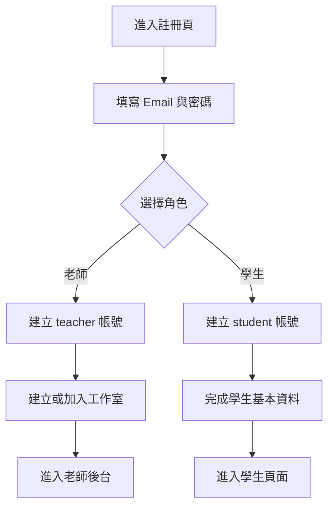
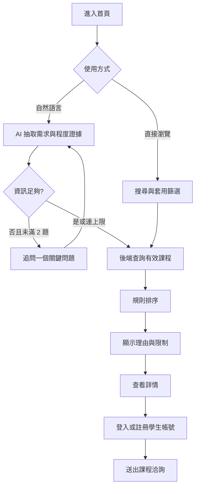
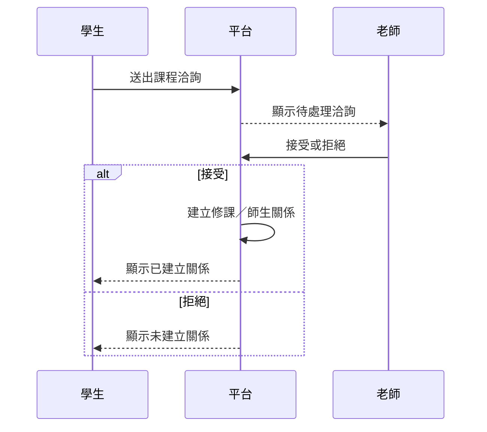
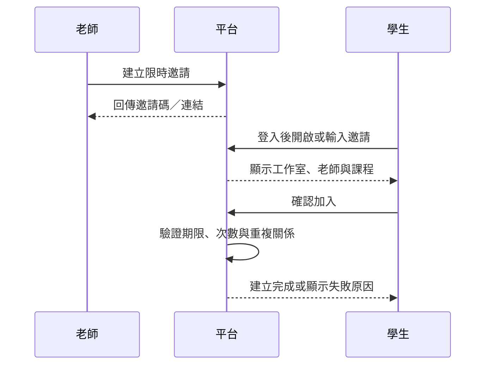
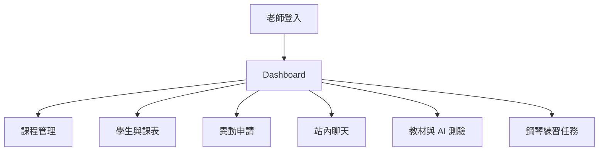
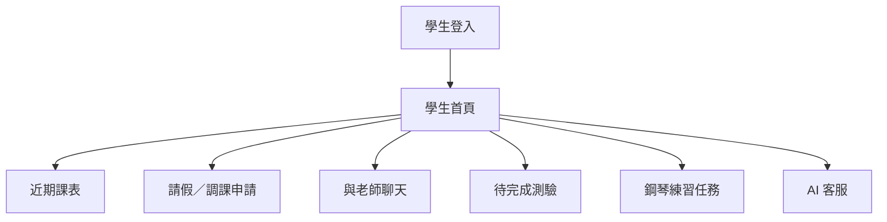
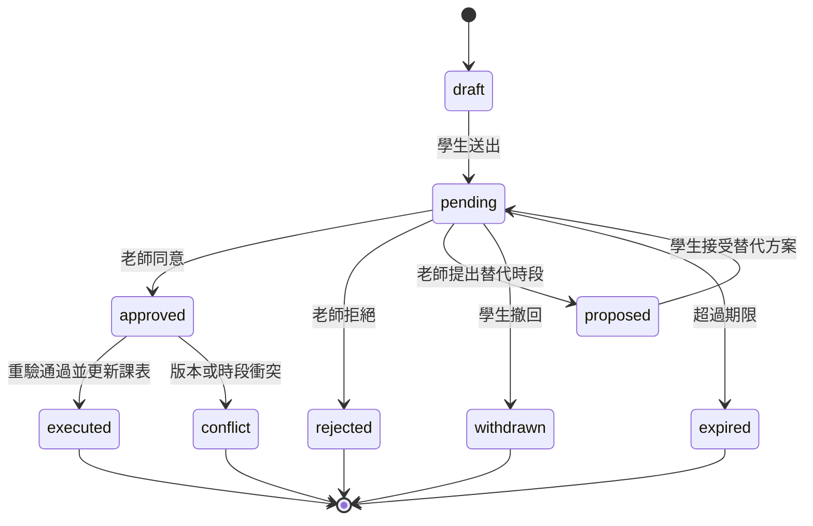
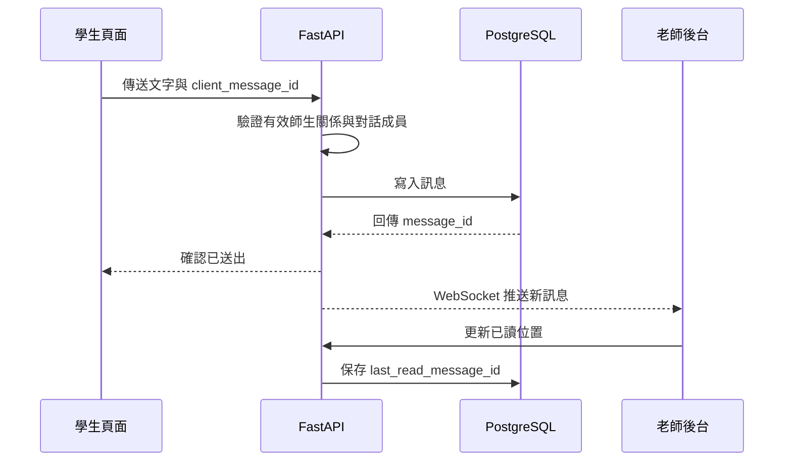
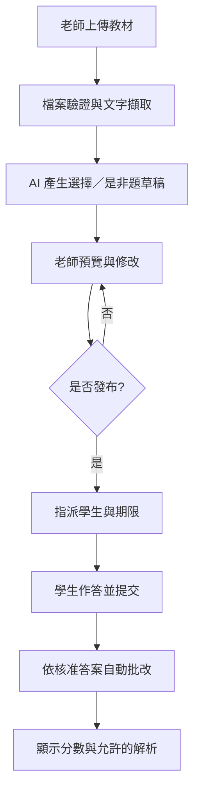
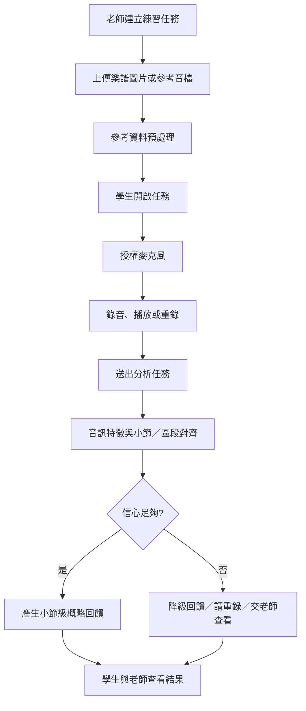

# 個人工作室智慧管理平台 User Flow

| 項目 | 內容 |
| --- | --- |
| 版本 | V1.2 |
| 對應文件 | PRD V1.2、SRS V1.2 |
| 最後更新 | 2026-09-24 |

## 1. 角色與入口

| 角色 | 入口 | 主要流程 |
| --- | --- | --- |
| 訪客 | 公開首頁 | 瀏覽課程、AI 推薦、平台 QA、註冊、洽詢 |
| 學生 | 學生頁面 | 課表、申請、聊天、測驗、鋼琴練習 |
| 老師 | 老師後台 | 課程、學生、課表、申請、聊天、教材與任務 |
| 平台管理員 | 管理後台 | 帳號、內容、異常與稽核 |

## 2. 註冊與固定角色

- MVP 角色建立後不可自行切換。
- 如選錯角色，使用者需聯繫平台管理員；不得只改前端欄位。

## 3. 首頁課程與 AI 推薦

AI 若收到平台使用問題，改由核准的 QA 知識回答；無答案時提供說明入口，不得捏造。

## 4. 師生關係建立

### 4.1 課程洽詢

### 4.2 老師邀請

## 5. 老師後台

## 6. 學生頁面

MVP 的 AI 客服不將聊天內容轉換成長期學生推薦檔案。

## 7. 請假／調課流程

1. 學生選擇自己的課堂與請假／調課類型。
2. 系統顯示原課堂、申請內容及可能影響。
3. 學生送出後，正式課表仍不變。
4. 老師同意時，後端重新檢查課堂版本、權限及衝突。
5. 通過才以單一交易更新課堂與申請狀態。

## 8. 一對一即時聊天

- WebSocket 中斷不等於訊息遺失；重連後依最後訊息位置補抓。
- 未讀數由後端根據已讀位置計算。
- MVP 僅支援文字訊息。

## 9. AI 測驗流程

若 AI 無法從教材取得足夠依據，題目保留為需人工補充，不能自動發布。

## 10. AI 鋼琴練習流程

可接受語句：

- 「第 4 小節速度稍慢，可以搭配節拍器再試一次。」
- 「第 8 小節錯音較集中，建議放慢速度確認樂譜。」

不可在證據不足時輸出：

- 精密到秒或音分的斷言。
- 將環境雜音直接判定為學生能力問題。
- 正式檢定等級或保證性結論。

## 11. 主要例外

| 例外 | 處理 |
| --- | --- |
| 邀請過期或撤銷 | 不建立關係，提示向老師索取新邀請 |
| 老師拒絕洽詢 | 不建立關係，保存處理狀態 |
| 課表申請等待期間時段被占用 | 標記 conflict，不部分更新 |
| WebSocket 中斷 | 自動重連並以 REST 補抓 |
| 重複送出聊天訊息 | 依 client_message_id 去重 |
| 教材無法解析 | 顯示失敗原因，允許老師更換檔案 |
| AI 題目缺乏教材依據 | 標記需人工修改，不允許直接發布 |
| 麥克風被拒絕 | 顯示瀏覽器權限說明，不建立空錄音 |
| 鋼琴錄音雜音過高 | 要求改善環境或重錄 |
| 小節對齊信心不足 | 降級為時間區段／整體回饋並標示限制 |

