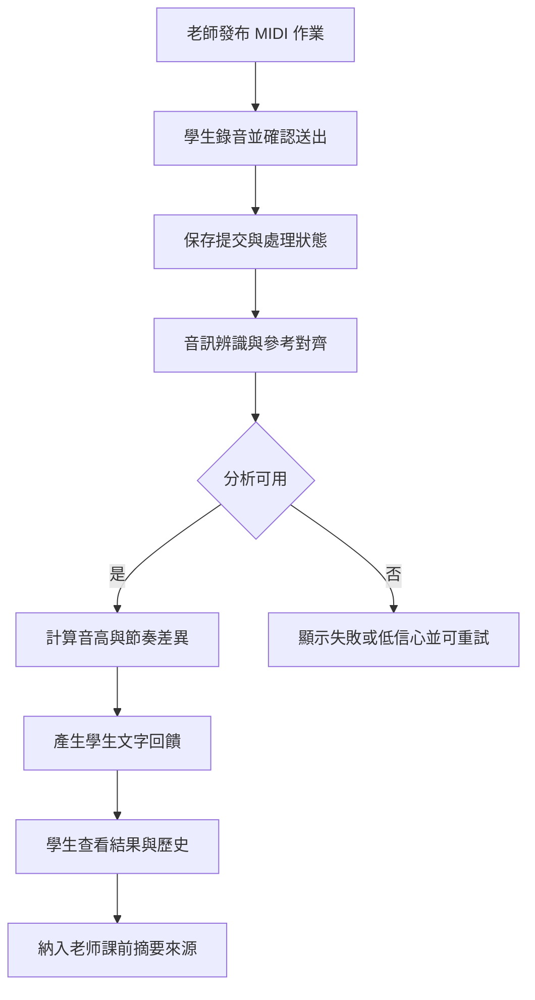
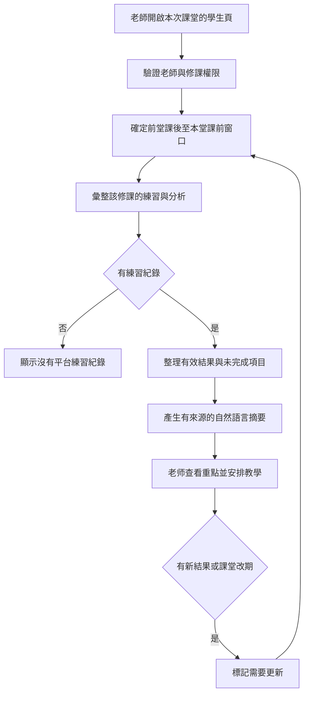

# 鋼琴教學管理與課程推廣平台 User Flow

版本 V1.2；更新 2026-09-30；所有角色使用網站，無 LINE。

## 1. 找課、推薦及站內洽詢

1. 訪客瀏覽公開鋼琴課程，也可描述學習目的、經驗、預算、地區與時間。
2. 智能推薦整理條件、初步程度與未知項目；必要時最多追問兩題。
3. 後端篩選有效課程並排序，顯示理由與不完全符合之處。
4. 訪客查看詳情並按洽詢，進入學生註冊／登入，登入後回到原課程。
5. 學生送出站內洽詢，老師在自己的課程洽詢清單回覆。
6. 洽詢只是詢問；後續提出加入，雙方同意才建立正式師生關係與修課。

沒有符合課程時讓使用者選擇修改條件，不虛構課程。程度推估不等於正式檢定。

## 2. 註冊與師生工作區

註冊時選單一老師／學生角色 → 完成基本資料 → 登入驗證 → 老師工作區或學生工作區。

老師工作區：課程推廣、洽詢、學生、課表／申請、聊天、MIDI 作業、練習紀錄、課前摘要、教材與測驗。

學生工作區：洽詢、加入老師、個人課表／申請、聊天、練習錄音與回饋、教材及測驗。

## 3. 鋼琴練習與回饋

參考答案必要為校驗 MIDI。錄完送出後快速回饋；先驗證短曲、單音／簡單雙手、無踏板。LLM 失敗時保留分析結果；不回傳假 0 分或編造小節。

## 4. 老師課前摘要

窗口採同一 enrollment、ends_at 不晚於本堂 starts_at 的最近一堂已完成課 ends_at 至 min(現在, 本堂 starts_at)，[起點, 終點)。首堂建議採修課開始時間；缺少則使用修課建立時間並明示。

摘要包含期間、提交次數與日期、最近有效表現、可比較的變化、反覆錯誤、建議上課重點及來源。不把平台提交次數當成全部實際練習次數。

## 5. 課務申請

學生查看課表 → 選約課／請假／調課 → 看申請摘要並送出 → 老師確認／拒絕 → 後端檢查身份、版本、到期狀態與衝突 → 交易內生效 → 雙方網站顯示結果。

學生送出視為發起方同意；老師同意前正式課表不變。異動失敗不部分更新。網站通知型態可先用待辦與狀態；不要求 LINE 或額外外部通知。

## 6. 站內聊天

有效師生關係 → 開啟一對一聊天室 → 保存訊息 → 即時通知對方 → 更新讀取進度與未讀數；重新連線可取回漏掉的歷史。

未建立正式關係者使用課程洽詢入口，不能直接進正式師生聊天室。關係解除後不接受新訊息，歷史保留政策另定。

## 7. 教材與 AI 測驗

老師上傳教材 → 抽取內容 → AI 產生選擇／是非題草稿 → 老師審核答案與解析 → 發布 → 有效修課學生作答 → 交卷 → 後端標準答案批改 → 顯示結果。

草稿不能直接上架；交卷前不傳正確答案。已發布版本固定，修改建立新版本，保留舊作答。

## 8. 異常處理

| 情況 | 使用者看見的處理 |
| --- | --- |
| 麥克風拒絕／檔案格式不符 | 清楚說明並讓使用者重試 |
| 分析尚未完成 | 處理中狀態，重新整理後仍可查 |
| 練習分析失敗 | 失敗原因代碼與重試入口，不當成沒練或 0 分 |
| 摘要產生失敗 | 保留個別練習紀錄供查看，可重新產生 |
| 摘要沒有紀錄 | 顯示期間無平台練習紀錄，不推論未練 |
| 改課衝突 | 正式課表保持原狀，顯示原因 |
| 推薦沒有結果 | 明示無符合項目，使用者自行選擇調整條件 |
