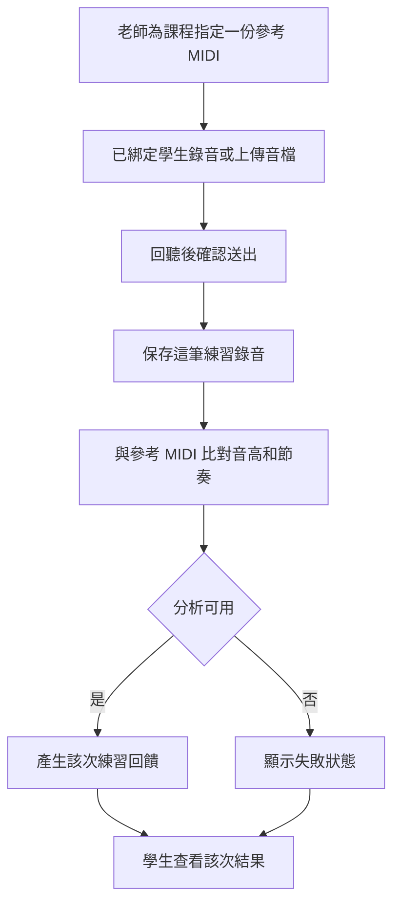

# 鋼琴教學管理與課程推廣平台 User Flow

版本 V1.3；更新 2026-10-12。正式畫面使用 Vue。所有角色使用網站，無 LINE。

## 1. 找課與首頁推薦

1. 訪客不必登入，描述想學的鋼琴內容。
2. 系統整理條件與找課程度。必要時最多追問兩題。
3. 找課程度只來自自述，分為入門、初階、中階、進階、不確定。
4. 系統只顯示資料庫裡的已發布課程，並說明理由與未知條件。
5. 沒有符合課程時明確說明，不編造課程。

## 2. 註冊

訪客要洽詢時，先註冊或登入，並回到原本那門課。

註冊維持單一老師或學生角色。老師仍走現有申請與平台管理員審核。這段不重做。

## 3. 洽詢與綁定前

1. 已註冊學生在已發布課程按洽詢。
2. 系統建立該學生、該老師、該課程的接洽對話。
3. 同一位學生可以同時接洽多門課。每段對話只屬於一門課。
4. 綁定前只能使用這段對話。不能使用課表、錄音、練習回饋、課前摘要與課程管理。

## 4. 綁定碼與正式上課

1. 老師決定收這位學生後，產生綁定碼。
2. 老師把綁定碼貼進該接洽對話。不寄信、不簡訊。
3. 學生輸入綁定碼，只進入這門課。
4. 原本的接洽對話繼續使用，不另開第二個聊天室。
5. 老師可解除自己課程的綁定。該課教學功能關閉，對話保留，其他課程不受影響。

## 5. 課表與課務申請

已綁定學生查看該課課表，提出約課、請假或調課。

老師同意，而且目標時段沒有被占用之後，正式課表才改變。之前課表維持原狀。

## 6. 練習錄音、評分與練習回饋

沒有麥克風時改上傳音檔。音高與節奏分開呈現。失敗不是 0 分。文字只依這一次的評分結果產生。

## 7. 課前摘要

老師查看一位已綁定學生、一門課的課前摘要。範圍是上一堂結束後到這一堂開始前。

有練習紀錄時，摘要整理這段期間的練習。沒有平台練習紀錄時，顯示沒有平台紀錄，不說成學生沒有練習。課前摘要不取代每一筆練習回饋，也不變成正式程度。

## 8. 接洽對話

對話從洽詢開始，綁定後仍是同一段。

重新開啟時看得到歷史與未讀。人留在對話頁時看得到新訊息。第三人不能讀取這段對話。

## 9. 本輪不做

教材上傳、AI 測驗出題、作答與批改不在這一輪的使用流程中。
