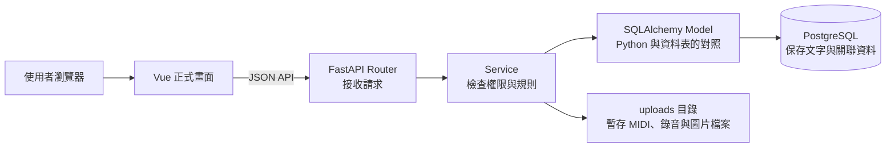
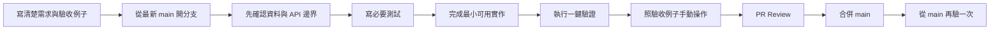

# 專案架構與開發驗證手冊

這份文件是團隊理解專案的第一入口。它回答四個問題：目前正式產品是哪一套、資料放在哪裡、功能應該怎麼開發，以及完成後要怎麼自己驗證。

## 1. 先記住六件事

1. `main` 是唯一長期保存正式產品的主線。
2. 每次開發都從最新的 `main` 建立新的功能分支，完成後用 Pull Request 合回 `main`。
3. `feature/backend`、`feature/frontend`、`feature/database-integration`、`feature/aicourse-integration` 都是這一輪的暫時整合分支，不是未來永久的開發基地。
4. 舊 `feature/AICourseFinder` 是研究原型，只能參考演算法與實驗結果；不要把整個分支合進正式產品，也不要繼續在那裡開發正式功能。
5. 正式課程只有一個來源：PostgreSQL 的 `courses` 資料表。老師建立並發布後，首頁、搜尋與推薦才能讀到。
6. 測試資料庫的名稱必須以 `_test` 結尾。正式資料與測試資料不可共用同一個資料庫。

## 2. 目前正式產品怎麼運作



用餐廳來比喻：

- Vue 是客人看到的菜單與點餐畫面。
- Router 是接單櫃台，確認請求要交給誰。
- Service 是廚房規則，例如「只有課程老師可以改這門課」。
- Model 是資料填寫格式，說明一筆課程有哪些欄位。
- PostgreSQL 是正式帳本，真正保存課程、使用者與關聯。
- Alembic 是帳本格式的版本紀錄，負責把舊資料庫安全改成新版。

### 為什麼 PostgreSQL 還需要 SQLAlchemy？

PostgreSQL 是真正保存資料的資料庫；SQLAlchemy 是 Python 程式操作資料庫的工具。兩者沒有各自存一份資料。以新增課程為例，程式建立 `Course(...)`，交給 `db.add()`、`db.commit()`，SQLAlchemy 便產生 SQL 指令送給 PostgreSQL。關閉 Python 程式後，資料仍在 PostgreSQL 裡。

可以不用 SQLAlchemy，改用資料庫驅動程式直接寫 SQL。本專案已選用 SQLAlchemy，讓課程欄位對照、查詢與一整組資料的提交／取消有共同寫法。資料庫的外鍵與唯一值限制仍由 PostgreSQL 執行；正式建表和改表則由 Alembic 負責。

### 主要目錄

| 位置 | 白話用途 | 修改時要一起確認 |
| --- | --- | --- |
| `frontend/src/views`、`components` | 使用者看得到的 Vue 頁面與元件 | API 回傳格式、手機版操作 |
| `frontend/src/api` | Vue 呼叫後端的集中位置 | 路徑、登入 Cookie、錯誤訊息 |
| `backend/routers` | FastAPI 的網址入口 | 輸入輸出格式、身分驗證 |
| `backend/services` | 權限、流程與商業規則 | 邊界情況、交易是否完整 |
| `backend/models` | Python 對資料表的現況說明 | Migration 是否同步 |
| `backend/schemas` | API 接收與回傳的資料格式 | 前端型別是否同步 |
| `alembic/versions` | 資料庫每次改版的歷史步驟 | 舊資料如何搬移、能否回復 |
| `tests` | 自動驗證重要規則 | 新功能是否涵蓋成功與拒絕情況 |
| `uploads` | 本機開發時的檔案內容 | 不可提交個資、錄音或教材 |

## 3. 資料到底存在哪裡

| 資料 | 正式來源 | 補充 |
| --- | --- | --- |
| 使用者、老師、學生 | PostgreSQL | 密碼只保存雜湊值 |
| 課程 | PostgreSQL `courses` | 只有 `published` 可公開顯示 |
| 首頁找課對談 | `recommendation_sessions` | 24 小時後失效 |
| 首頁推薦結果 | `recommendation_items` | 一定指向正式 `courses` |
| MIDI、錄音、圖片的說明資料 | PostgreSQL | 保存檔名、位置、大小等資訊 |
| MIDI、錄音、圖片的檔案內容 | 目前在 `uploads` | 上線前應移到有備份與權限控制的物件儲存 |
| 舊 AI 假課程與向量 | 舊原型的另一套資料庫 | 不屬於正式產品，不可當成正式課程匯入 |

老師未來建立正式課程時，流程是：老師在 Vue 填寫 → FastAPI 檢查 → 寫入 `courses` → 老師發布 → 公開課程 API、搜尋與推薦讀取同一筆資料。團隊不需要另外維護一份「AI 課程表」。

## 4. 搜尋、首頁推薦與 RAG 是三件不同的事

| 功能 | 使用者想做什麼 | 資料來源 | 目前狀態 |
| --- | --- | --- | --- |
| 課程搜尋 | 輸入老師、課名、地區等關鍵字找課 | 正式 `courses` 與老師資料 | 已有 `/courses` 全部課程頁，前端篩選已發布課程；後端搜尋與分頁待優化 |
| 首頁推薦 | 用自然語句描述需求，由系統追問並推薦課程 | 正式且已發布的 `courses` | 已整合；目前使用可重現的明確規則 |
| RAG 知識問答 | 針對核准文件提問，回答時指出根據哪份資料 | 經核准並有版本的知識文件 | 舊原型做過實驗，尚未整合正式產品 |

RAG 可以理解成「先翻指定資料，再整理答案」。它不負責建立課程，也不能把模型想像出的課程寫進資料庫。與課程有關的名稱、價格、老師、地點和時段仍以 `courses` 為準。

## 5. 每個功能都走同一套流程



### 開工前：需求要先達到這些條件

- 說得出誰會使用、要解決什麼問題。
- 至少寫出一個成功例子和一個不應允許的例子。
- 指定正式資料來源，不能只寫「交給 AI」。
- 說明會修改哪些畫面、API 和資料表。
- 若會新增或修改資料表，先確認 Alembic 目前只有一個 head。
- 說明如何判斷答案正確，例如搜尋結果必須都是已發布課程。

### 實作中：每一層只做自己的工作

1. Vue 收集輸入並顯示結果。
2. Router 接收請求與回傳資料。
3. Service 處理權限與規則。
4. Model 表達目前資料結構。
5. Alembic 改變真實資料庫結構。
6. Test 證明主要成功流程與禁止行為。

### 可合併的最低標準

- 程式從最新整合基準更新，沒有未解決衝突。
- `python scripts/verify_merge.py` 全部通過。
- 需求中的成功與失敗例子已由真人在畫面操作一次。
- 新資料表有 Migration、Model、測試及資料字典說明。
- API、前端型別與畫面使用相同欄位名稱。
- 沒有 `.env`、密碼、Token、真實個資、錄音或教材被提交。
- PR 說明包含「做了什麼、為什麼、如何驗證、已知限制」。
- Reviewer 可以只看 PR 與本文件就重做驗證。

### 可發布的最低標準

- Pull Request 已合進 `main`，並從最新 `main` 再執行一次驗證。
- 正式資料庫升級前已備份，且團隊知道如何還原。
- 在接近正式環境的設定完成登入、課程建立、發布、搜尋／推薦等冒煙測試。
- 上線後可查看錯誤紀錄、資料庫連線與磁碟使用狀況。

## 6. 你可以怎麼自行驗證

### 自動檢查

第一次先複製 `.env.example` 為 `.env`，並啟動 PostgreSQL：

```bash
docker compose up -d postgres
python scripts/verify_merge.py
```

這個指令會：

1. 拒絕使用名稱不是 `_test` 結尾的測試資料庫。
2. 必要時建立本機測試資料庫。
3. 把測試資料庫升到最新 Alembic 版本。
4. 執行後端與 Migration 測試。
5. 確認 Model 與 Migration 沒有漏同步。
6. 檢查 Vue 程式、型別並建立正式版前端檔案。

看到「全部驗證通過」才代表自動檢查完成。它不取代畫面操作。

### 首頁推薦的手動驗收

1. 老師建立兩門條件不同的課，其中一門發布、另一門保留草稿。
2. 未登入訪客在首頁找課助理輸入「我是初學者，想找線上流行鋼琴」。
3. 確認最多只追問兩題。
4. 確認結果只出現已發布課程，名稱、老師和價格與老師建立的資料相同。
5. 把該課改成封存，再讀取原推薦；該課不應繼續顯示。
6. 用另一個瀏覽器嘗試讀取原對談；不應讀到別人的內容。

### 未來課程搜尋的手動驗收

1. 建立已發布、草稿、封存三種課程。
2. 用完整課名、部分課名、老師名與地區分別搜尋。
3. 結果只能包含已發布課程。
4. 空白、無結果、特殊符號與很長的文字都要有合理畫面。
5. 點結果必須進入同一筆正式課程，不可顯示前端假資料。

### 未來 RAG 的手動驗收

1. 準備一份核准文件，記錄來源、版本與更新時間。
2. 問文件內明確有答案的問題，回答必須附來源段落。
3. 問文件沒有提到的問題，系統應回答資料不足，不可猜測。
4. 修改文件並重建索引，舊版本不應和新版本混用。
5. 問課程價格時，仍須查正式課程資料，不可只憑文件或模型回答。

## 7. 合併完成後，RAG 與搜尋要怎麼繼續

每一階段都從當時最新的 `main` 建立新分支。不要從 `feature/AICourseFinder` 接著寫。

### 第一階段：完成正式課程搜尋

- 沿用既有 `/courses` 頁面，將前端篩選逐步接到後端搜尋 API；先與前端負責人確認 `/search` 的去留。
- 先支援課名、老師、程度、地區、方式與價格等資料庫欄位。
- 定義排序、分頁、無結果和只顯示已發布課程的規則。
- 建議分支：`feature/course-search-v1`。

### 第二階段：改善文字搜尋品質

- 先記錄真實使用者會輸入的關鍵字與找不到結果的情況。
- 再評估 PostgreSQL 全文搜尋、同義詞與錯字處理。
- 用固定測試題清單比較修改前後，不可只憑「感覺比較聰明」。

### 第三階段：加入向量排序實驗

- 只把向量用在候選課程的補充召回或重新排序。
- 課程內容仍從 `courses` 讀取。
- 建立離線評估集，至少記錄正確課程是否進入前幾名、查詢時間與無結果率。
- 實驗達標後才進正式 API；模型名稱與向量版本必須可追蹤。

### 第四階段：正式 RAG 問答

- 先定義允許放入知識庫的文件種類、負責人和更新規則。
- 每個文件片段保存來源、版本與有效狀態。
- 回答必須附來源；沒有根據就明確說不知道。
- 知識文件、向量索引與使用者對話分開保存，並定義保存期限。
- 若需要新資料表，版本號必須接在合併當下的 Alembic 唯一 head 之後，不預先寫死編號。

## 8. 舊 AICourseFinder 可以拿什麼、不能拿什麼

可以參考：

- 測試問題與評估方法。
- 關鍵字、向量排序、RAG 切片的研究結果。
- 有測試證明且能改接正式 `courses` 的單一演算法。

不可直接沿用：

- Next.js 畫面與獨立啟動方式。
- `AI_DATABASE_URL` 和另一套 Migration 鏈。
- `ai_public_courses`、`ai_public_teachers` 等假資料表作為正式來源。
- 把整個分支合入 `main`。

若要採用舊程式，應在新分支逐小段搬入，先改成正式資料來源，再補測試。這樣每一次改動都能說清楚「搬了什麼、為什麼、如何證明沒有破壞產品」。

## 9. 當你看不懂一個改動時

請要求實作者用以下五句話回答，任何一句答不出來就先不要合併：

1. 使用者原本遇到什麼問題？
2. 這次改了哪個畫面、API、規則或資料表？
3. 正式資料從哪裡讀、寫到哪裡？
4. 我可以照哪些步驟親自看到結果？
5. 如果失敗，如何停止或回到上一版？

更細的資料表說明請看 `docs/database/data-dictionary.md`；資料庫改版與還原請看 `docs/database/migration-runbook.md`；已確定且不應被任意改寫的架構決定請看 `docs/adr/`。

## 10. 舊原型功能接續開發的具體位置

合併完成後，先更新 `main`，再建立如 `codex/rag-search-v1` 的新分支。這個分支仍使用同一個專案資料夾、Vue、FastAPI 與正式課程表，測試也在該分支執行。分支名稱只是標記本次工作，不會另外建立一個網站或資料庫。

| 想接續的功能 | 正式產品的實作位置 | 第一次驗收重點 |
| --- | --- | --- |
| 自然語言需求理解 | `backend/services/recommendation.py`，複雜時拆成獨立解析服務 | 同一句需求解析成哪些條件；不確定不能猜 |
| 推薦排序 | `backend/services/recommendation.py` | 正式已發布課程、價格等條件不可被排序模型放寬 |
| 搜尋畫面 | `frontend/src/views/CoursesView.vue` | 篩選、排序、網址條件與無結果畫面 |
| 後端課程搜尋 | `backend/routers/public_courses.py` 與對應 service | 未發布課程不外洩、分頁不漏課 |
| 向量與 RAG | 新增專責 service；需要資料表時新增 Model 與 Alembic Migration | 文件來源、版本、引用、資料不足時不猜 |
| AI 助理畫面 | `frontend/src/components/common/AiAssistButton.vue` | 顯示結果與來源、錯誤時可重試 |

搬運方式是一次選一項功能：記錄舊版輸入與預期結果 → 在新分支寫相同案例 → 搬入需要的演算法並改接正式來源 → 跑自動與人工驗收 → PR 合併。舊假資料可作獨立測試案例，不能當成正式老師發布的課程。
