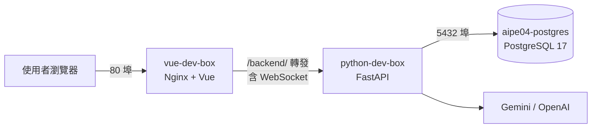

# 維運工作紀錄

負責人：雄（DevOps，GitHub 帳號 Cliff）

負責範圍：Docker 環境、環境變數、服務之間的連線、資料庫備份，以及系統監測。

## 一、系統部署架構

整個系統用 Docker Compose 一次啟動三個容器，彼此透過內部網路 `app-network` 連線。



| 容器 | 用途 | 對外埠 |
|---|---|---|
| `vue-dev-box` | Nginx 提供 Vue 網頁，並把 `/backend/` 的請求轉給後端 | 80 |
| `python-dev-box` | FastAPI 後端，啟動時先自動升級資料庫結構 | 8000 |
| `aipe04-postgres` | PostgreSQL 資料庫，資料存在 `postgres17_data` volume | 5432 |

## 二、已完成的工作

### 1. 建立 Docker 開發環境（2026-09-16）

- 建立後端 Dockerfile、`docker-compose.yml` 和套件清單。
- 效果：組員不必自己安裝 Python 和套件，執行 `docker compose up` 就能啟動同一套環境，避免「我的電腦可以跑，你的不行」。

### 2. 前後端分離（2026-10-19）

- 後端的 Dockerfile 和套件清單移到 `backend/`，另外建立 `frontend/Dockerfile` 和 `frontend/nginx.conf`。
- 前端的 Dockerfile 分兩階段：先用 Node 把 Vue 打包成靜態網頁，再交給 Nginx 提供，正式映像裡不帶 Node 和原始碼。
- Nginx 負責兩件事：
  - 提供網頁
  - 把 API 和 WebSocket 請求轉給後端容器
- 效果：瀏覽器只要連一個網址。前端和後端分別打包，可以各自更新。

### 3. 新增 `.dockerignore`（2026-10-19）

- 前後端各自排除不需要放進映像檔的檔案，例如 `node_modules`、`.env`、快取。
- 效果：映像檔變小、打包變快，也避免把金鑰打包進映像檔。

### 4. 啟動時自動升級資料庫結構（2026-10-19）

- 後端啟動指令改成先執行 `alembic upgrade head`，再啟動 Uvicorn。
- 效果：組員拉下新程式後，資料表會自動更新到最新版，不用手動執行 migration。

### 5. 建立環境變數範本 `.env.example`（2026-10-19）

- 列出資料庫連線、Session 金鑰、管理員帳號、LLM 金鑰等設定。
- 效果：真正的 `.env` 不放進 Git，金鑰不會外洩。新組員複製範本、填入自己的值就能啟動。這符合 PRD F10 的要求：「`.env`、金鑰與密碼不放進映像檔或 Git」。

### 6. 資料庫一鍵備份與還原 `db-helper.sh`（2026-10-19）

```bash
bash db-helper.sh backup    # 備份到 db-backups/，檔名帶時間
bash db-helper.sh restore   # 從最新一份備份還原
```

- 效果：改資料表結構或測試之前可以先備份，出問題時能快速還原。

### 7. 資料庫健康檢查（2026-10-20）

- PostgreSQL 每 5 秒用 `pg_isready` 檢查一次。後端設定成等資料庫健康才啟動。
- 效果：解決「資料庫還沒準備好，後端就先啟動而連線失敗」的問題。

### 8. 整合後確認網頁可以開啟（2026-10-21）

- 把 alembic 相關檔案移到 `backend/` 底下，配合容器裡的路徑，確認整套服務啟動後網頁可以正常開啟。

### 9. 系統監測：第一階段（2026-10-29）

這部分的目標是讓系統出問題時「看得到」，而且能「自己恢復」。

| 項目 | 做法 | 效果 |
|---|---|---|
| 健康檢查 API 回報真實狀態 | `/health` 對資料庫執行 `SELECT 1`。正常回 200；連不上就回 **503**，並把錯誤寫進日誌 | 以前不論狀況都回 ok。現在監測工具能分辨服務是不是真的能用 |
| 後端容器健康檢查 | Docker 每 30 秒在容器裡呼叫 `/health`，連續 3 次失敗就標成 `unhealthy`。啟動後的前 40 秒失敗不算，因為要等 migration 跑完 | `docker ps` 直接顯示 `(healthy)` 或 `(unhealthy)` |
| 自動重啟 | 後端和資料庫設定 `restart: unless-stopped` | 程式崩潰，或 Docker、電腦重開後，服務會自己回來 |
| 啟動順序 | 前端改成等後端健康才啟動 | Nginx 不會因為找不到後端而一直重啟 |

**實測結果：**

| 測試情境 | 結果 |
|---|---|
| 資料庫正常時呼叫 `/health` | `200 {"status":"ok","database":"ok"}` |
| 手動停掉資料庫後呼叫 `/health` | `503 {"status":"error","database":"error"}`，後端日誌記下連線錯誤 |
| 資料庫停掉後，觀察後端容器 | 約 90 秒後變成 `unhealthy`；資料庫恢復後 10 秒內回到 `healthy` |
| 在容器裡強制結束後端程式 | Docker 自動重啟，重啟次數 0 → 1，約 15 秒後回到 `healthy` |
| 經過 Nginx 呼叫 `/backend/health` | `200`，前端到後端的轉發正常 |

## 三、過程中發現並處理的問題

| 問題 | 原因 | 處理 |
|---|---|---|
| Docker Desktop 重開後，網站打不開，前端容器一直重啟 | 後端和資料庫沒有設定自動重啟，Docker 重開後沒有回來，Nginx 找不到後端 | 加上 `restart: unless-stopped`，前端改成等後端健康才啟動 |
| 經過 80 埠呼叫 `/backend/...` 拿到的是首頁 | 前端容器還在用舊映像：`nginx.conf` 改成轉發 `/backend/` 之後，映像沒有重新 build | 執行 `docker compose build frontend` 重新打包，驗證轉發正常 |

學到的經驗：**改了 Dockerfile 或會被複製進映像的檔案（例如 `nginx.conf`），一定要重新 build。** 只有用 volume 掛載的後端程式碼，存檔就會生效。

## 四、接下來的計畫

監測分三階段進行：

| 階段 | 內容 | 狀態 |
|---|---|---|
| 第一階段：基本功 | 健康檢查、自動重啟、限制日誌大小 | 進行中，只剩限制日誌大小 |
| 第二階段：服務存活監測 | 架設 Uptime Kuma，定時檢查網站和 `/health`，服務中斷時發通知到 Discord 等通訊軟體 | 未開始 |
| 第三階段：效能指標與儀表板 | Prometheus + Grafana，收集 API 回應時間、錯誤率、容器資源用量、音訊評分耗時、LLM 失敗次數 | 未開始 |

第三階段要收集的指標，對應的是 SAD 文件第 15 節「可觀測性」的要求：記錄 API latency、分析時長、AI 失敗、WebSocket 失敗。

## 五、待處理事項

- 前端 Dockerfile 用的是 Node 20，但 `package.json` 要求 Node 22 以上。目前可以打包成功，但會出現警告，需要和前端組員確認是否升級。
- `db-helper.sh` 目前要手動執行，之後可以考慮排程定期備份。
