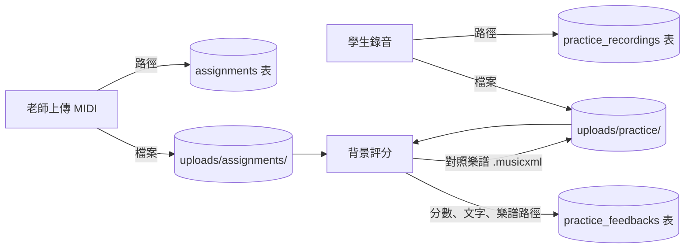

# 音訊上傳與評分：資料怎麼跑

> 給資料庫組員：老師上傳的 MIDI、學生上傳的錄音，存在哪裡、經過哪些程式、寫進哪些資料表，以及怎麼自己測一次。
> 行號以 2026-10-27 的 `main` 為準，之後改程式可能會偏幾行，用函式名稱搜尋最準。

---

## 先看 30 秒版

- **檔案本身**存在本機硬碟的 `uploads/` 資料夾，**不存在資料庫裡**。
- **資料庫只存路徑字串**，例如 `uploads/practice/<學生id>/<錄音id>.webm`。
- 路徑一律是「相對專案根目錄」，由 `backend/core/uploads.py` 的兩個函式負責轉換：
  - `stored_path(path)`：實際檔案 → 要寫進資料庫的字串
  - `resolve_stored_path(value)`：資料庫的字串 → 實際檔案
- 學生錄音送出後，**評分在背景跑**（約幾秒到半分鐘），跑完才寫入分數、回饋文字和對照樂譜。



---

## 檔案放在哪（資料夾地圖）

| 資料夾 | 放什麼 | 檔名規則 | 誰寫的 |
| --- | --- | --- | --- |
| `uploads/assignments/<老師id>/` | 作業的參考 MIDI、作業教材（PDF、音檔…） | `<隨機uuid>.mid`、`<隨機uuid>.pdf` | `backend/services/assignment.py` 的 `_write()`（第 33 行） |
| `uploads/practice/<學生id>/` | 學生的練習錄音 | `<錄音id>.webm`／`.mp3`／`.wav`… | `backend/services/student.py` 的 `save_recording()`（第 359 行） |
| `uploads/practice/<學生id>/` | 這次的對照樂譜 | `<錄音id>.musicxml`（跟錄音同名） | `backend/services/practice.py` 的 `_analyze()`（第 69 行） |
| `uploads/midi/<老師id>/` | 舊功能：整門課共用的參考 MIDI（現在畫面已改用作業的 MIDI，API 還在） | `<隨機uuid>.mid` | `backend/services/course.py` 的 `save_reference_midi()`（第 78 行） |

- `uploads/` **沒有放進 Git，也不要提交**，每個人電腦裡的檔案不一樣。
- Docker 把電腦上的 `./uploads` 掛到容器的 `/app/uploads`（見 `docker-compose.yml`），所以容器寫的檔案在電腦上看得到。
- 評分時的中間檔（轉好的 wav、學生的 MIDI）放在系統暫存資料夾，**評完就刪掉**，不會留在 `uploads/`。

---

## 資料表地圖（只列和音訊有關的欄位）

| 資料表 | 欄位 | 意思 |
| --- | --- | --- |
| `assignments` | `midi_path` | 參考 MIDI 的路徑 |
|  | `midi_filename` | 老師上傳時的原始檔名（下載時用） |
|  | `midi_bpm` | MIDI 本身的速度，上傳時讀出來存的 |
|  | `practice_bpm` | 老師指定的練習速度（可空） |
| `assignment_materials` | `file_path`、`filename`、`content_type`、`file_size_bytes` | 一份作業的每個教材檔，一檔一列 |
| `practice_recordings` | `file_path` | 錄音檔路徑 |
|  | `reference_midi_path` | **送出當下**用的參考 MIDI 路徑（老師之後換曲子，舊錄音仍知道跟哪首比） |
|  | `metronome_bpm` | 錄音時開的節拍器速度，沒開是空的 |
|  | `assignment_id` | 交的是哪份作業 |
|  | `status` | `pending` → `processing` → `completed` 或 `failed` |
| `practice_feedbacks` | `pitch_score`、`rhythm_score` | 音高（滿分 70）、節奏（滿分 30）。失敗時是空的，不是 0 |
|  | `feedback_text` | 給學生看的文字回饋 |
|  | `score_sheet_path` | 對照樂譜（MusicXML）路徑 |
|  | `status` | `pending` → `completed` 或 `failed` |
| `courses` | `reference_midi_path` | 舊功能：課程共用的參考 MIDI |

每一筆錄音一定有一筆回饋（一對一，`practice_feedbacks.recording_id`）。

---

## 流程一：老師上傳 MIDI（發作業）

| 步驟 | 在哪個檔案 | 哪個函式 | 做了什麼 |
| --- | --- | --- | --- |
| 1 | `frontend/src/views/teacher/TeacherAssignmentFormView.vue` | `save()`（第 75 行） | 老師按「儲存」，收集表單和選好的 MIDI、教材 |
| 2 | `frontend/src/api/teacher.ts` | `createAssignment()`（第 101 行） | 包成 multipart，`POST /teacher/assignments` |
| 3 | `backend/routers/assignments.py` | `api_create_assignment()`（第 56 行） | 收到檔案，讀出內容 |
| 4 | `backend/services/assignment.py` | `create_assignment()`（第 61 行） | 檢查學生有綁定、MIDI 格式（`_check_midi()` 第 52 行，最大 2 MB）、教材大小（每個 30 MB、最多 10 個） |
| 5 | 同上 | `_write()`（第 33 行） | **寫檔**到 `uploads/assignments/<老師id>/<uuid>.mid` |
| 6 | 同上 | `_midi_bpm()`（第 41 行） | 讀出 MIDI 速度 |
| 7 | 同上 | `create_assignment()` 後段 | **寫資料庫**：`assignments` 一列（`midi_path`、`midi_bpm`…），每個教材在 `assignment_materials` 一列 |

下載 MIDI（不寫東西，只讀）：

- 老師：`backend/routers/assignments.py` 的 `api_teacher_assignment_midi()`（第 98 行）
- 學生：同檔 `api_student_assignment_midi()`（第 139 行）

---

## 流程二：學生上傳錄音 → 背景評分

### A. 送出（學生按下「確認送出」，馬上完成）

| 步驟 | 在哪個檔案 | 哪個函式 | 做了什麼 |
| --- | --- | --- | --- |
| 1 | `frontend/src/components/console/AudioRecorder.vue` | `start()`（第 58 行）／`onFile()`（第 97 行）→ `submit()`（第 118 行） | 網頁錄音（瀏覽器多半錄成 webm）或選一個音檔；開了節拍器就一起帶速度 |
| 2 | `frontend/src/views/student/StudentAssignmentView.vue` | `submit()`（第 46 行） | 呼叫 API |
| 3 | `frontend/src/api/student.ts` | `submitAssignment()`（第 65 行） | `POST /api/student/assignments/{作業id}/recordings`（欄位 `audio`、`metronome_bpm`） |
| 4 | `backend/routers/assignments.py` | `api_submit_assignment()`（第 183 行） | 收檔，並排一個背景工作 |
| 5 | `backend/services/student.py` | `save_recording()`（第 359 行） | 檢查格式與大小（最大 20 MB）；第 370 行決定參考 MIDI（作業的，沒有才用課程的） |
| 6 | 同上 | `save_recording()`（第 384～387 行） | **寫檔**到 `uploads/practice/<學生id>/<錄音id>.<副檔名>` |
| 7 | 同上 | `save_recording()`（第 407 行起） | **寫資料庫**：`practice_recordings` 一列、`practice_feedbacks` 一列，狀態都是 `pending` |

### B. 背景評分（送出後自己跑）

| 步驟 | 在哪個檔案 | 哪個函式 | 做了什麼 |
| --- | --- | --- | --- |
| 1 | `backend/services/practice.py` | `run_recording_analysis()`（第 22 行）→ `_analyze()`（第 30 行） | 狀態改成 `processing`（第 44 行） |
| 2 | 同上 | `_analyze()`（第 55 行） | 用 `resolve_stored_path()` 找到 MIDI 和錄音的實際檔案，交給評分 |
| 3 | `backend/audio_scoring/scorer.py` | `score_recording()`（第 28 行） | 開一個暫存資料夾（第 42 行），依序跑下面的步驟 |
| 4 | `backend/audio_scoring/midi_test.py` | `preprocess_audio()`（第 218 行）、`load_audio()`（第 251 行） | 讀音檔、轉單聲道、去頭尾靜音。webm／m4a 先用 ffmpeg 轉 wav |
| 5 | 同上 | `read_midi_notes()`（第 394 行） | 讀老師的 MIDI，取出每顆音 |
| 6 | 同上 | `convert_audio_to_midi()`（第 304 行） | 用 Basic Pitch 把錄音轉成音符；`remove_false_notes()`（第 331 行）濾掉泛音等假音 |
| 7 | 同上 | `align_notes_with_dtw()`（第 520 行） | 把學生的音對到答案的音 |
| 8 | 同上 | `score_performance()`（第 663 行） | 算音高 70、節奏 30；有節拍器照節拍器速度；`find_tempo_changes()`（第 779 行）找突然變快變慢 |
| 9 | 同上 | `build_score_report()`（第 1086 行）、`list_problems()`（第 1120 行） | 整理成報告，列出「真正的問題」 |
| 10 | 同上 | `generate_feedback()`（第 1193 行） | 交給 `backend/services/llm.py` 的 `generate_text_with_reason()`（第 53 行）寫文字回饋（Gemini 或 OpenAI，`.env` 切換）；失敗就改用規則產生的文字 |
| 11 | `backend/audio_scoring/score_sheet.py` | `build_comparison_musicxml()`（第 86 行） | 產生對照樂譜（MusicXML 文字） |
| 12 | `backend/services/practice.py` | `_analyze()`（第 69 行起） | **寫檔**：對照樂譜存成錄音旁邊的 `.musicxml`；**寫資料庫**：分數、文字、`score_sheet_path`，狀態改成 `completed` |
| ✕ | 同上 | `_mark_failed()`（第 77 行） | 任何一步失敗：分數留空、文字寫原因，狀態 `failed` |

### C. 之後讀回來（只讀）

| 誰 | API | 在哪個函式 |
| --- | --- | --- |
| 學生聽自己的錄音 | `GET /api/student/recordings/{id}/audio` | `backend/routers/student.py` 的 `api_my_recording_audio()`（第 274 行） |
| 學生看對照樂譜 | `GET /api/student/recordings/{id}/score-sheet` | 同檔 `api_my_score_sheet()`（第 288 行） |
| 老師聽錄音 | `GET /teacher/recordings/{id}/audio` | `backend/routers/teacher_practice.py` 的 `download_recording()`（第 79 行） |
| 老師看對照樂譜 | `GET /teacher/recordings/{id}/score-sheet` | 同檔 `download_score_sheet()`（第 63 行） |
| 前端畫樂譜 | — | `frontend/src/components/console/ScoreCompare.vue` 的 `onMounted`（第 14 行），用 OpenSheetMusicDisplay 畫 |

---

## 想改成物件儲存（object storage）時，要動哪裡

現在所有「寫檔」「讀檔」都集中在下面這幾個地方，換成 S3、MinIO 這類物件儲存時，只要改這些：

| 動作 | 位置 |
| --- | --- |
| 路徑和實體檔案的轉換 | `backend/core/uploads.py` 的 `stored_path()`、`resolve_stored_path()` |
| 寫作業 MIDI、教材 | `backend/services/assignment.py` 的 `_write()` |
| 寫學生錄音 | `backend/services/student.py` 的 `save_recording()`（`path.write_bytes`） |
| 寫對照樂譜 | `backend/services/practice.py` 的 `_analyze()`（`sheet_path.write_text`） |
| 寫課程 MIDI（舊） | `backend/services/course.py` 的 `save_reference_midi()` |
| 刪作業時刪檔 | `backend/services/assignment.py` 的 `delete_assignment()`（第 151 行） |
| 下載（回傳檔案） | 上面「C. 之後讀回來」那幾個函式，加上兩個 MIDI 下載函式，都用 `FileResponse` |

要注意：評分程式（Basic Pitch、librosa）需要**本機檔案路徑**，用物件儲存時要先下載到暫存資料夾再評分。

---

## 怎麼測試

> 下面的指令在專案根目錄執行，Docker 要先啟動（`docker compose up -d`）。
> 用 Git Bash 的話，先執行 `export MSYS_NO_PATHCONV=1`，不然 `/app` 路徑會被改掉。

### 測試 1：自動測試（最快，約 20 秒）

```bash
docker cp tests python-dev-box:/app/
```

```bash
docker exec python-dev-box sh -c "cd /app && python -m pytest tests/test_assignments.py tests/test_practice.py tests/test_audio_scoring_rules.py tests/test_llm.py -q"
```

| 測試檔 | 測什麼 |
| --- | --- |
| `tests/test_assignments.py` | 老師發作業附 MIDI、學生下載、交錄音、節拍器速度有記下來、對照樂譜下載、別人看不到 |
| `tests/test_practice.py` | 錄音狀態從 `pending` 到 `completed`／`failed`，失敗不寫 0 分 |
| `tests/test_audio_scoring_rules.py` | 泛音過濾、節拍器評分、突然變快、對照樂譜的顏色與音符長度 |
| `tests/test_llm.py` | LLM 切換、逾時重試、失敗原因 |

這些測試用暫存資料夾，**不會動到你的 `uploads/` 和本機資料庫的資料**。

### 測試 2：只跑評分，不經過網站（看辨識結果）

```bash
docker exec python-dev-box sh -c "cd /app && python backend/audio_scoring/midi_test.py --midi backend/audio_scoring/midi_test_data/test2.mid --audio backend/audio_scoring/audio_test_data/test1.wav"
```

會印出音符數、音高／節奏分數、錯音和 AI 回饋。中間檔寫在 `backend/audio_scoring/processed_audio/`、`converted_midi/`（不在 Git 裡）。

### 測試 3：在網站上走一次，看檔案和資料表

1. 老師登入 → 「作業」→「新增」→ 選學生、上傳 MIDI → 儲存
2. 學生登入 → 「作業」→ 點那份作業 → 錄音或上傳音檔 → 確認送出
3. 等半分鐘，繳交紀錄出現分數，按「看對照譜」
4. 看檔案有沒有出現：

```bash
ls uploads/assignments uploads/practice
```

5. 看資料庫（最新 5 筆錄音與回饋）：

```bash
docker exec aipe04-postgres psql -U aipe04 -d aipe04 -c "select r.file_path, r.reference_midi_path, r.metronome_bpm, r.status, f.pitch_score, f.rhythm_score, f.score_sheet_path from practice_recordings r join practice_feedbacks f on f.recording_id = r.id order by r.submitted_at desc limit 5"
```

6. 看作業的 MIDI：

```bash
docker exec aipe04-postgres psql -U aipe04 -d aipe04 -c "select title, midi_path, midi_filename, midi_bpm, practice_bpm from assignments order by created_at desc limit 5"
```

實際跑出來會長這樣（路徑裡的 id 每個人不一樣）：

| file_path | reference_midi_path | metronome_bpm | status | score_sheet_path |
| --- | --- | --- | --- | --- |
| `uploads/practice/6b19…/2601….webm` | `uploads/assignments/50eb…/c10c….mid` | 120 | completed | `uploads/practice/6b19…/2601….musicxml` |

---

## 常見問題

**錄音一直是「分析中」？**
看後端紀錄：`docker logs --tail 50 python-dev-box`。評分失敗或 LLM 失敗的原因都會寫在這裡。

**資料庫有路徑，但檔案找不到？**
`uploads/` 不在 Git 裡。別人電腦上傳的檔案，你這裡不會有。

**分數是空的？**
代表評分失敗（狀態 `failed`），`feedback_text` 會寫原因。系統規定失敗不能寫成 0 分。
